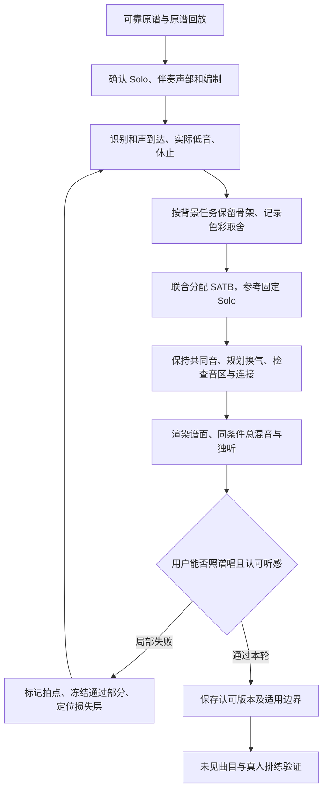

# 阿卡贝拉编配方法：从可靠伴奏到可唱的声部

这份方法来自《空耳》三个短段落的反复试听，不是整曲或跨曲风能力的证明。
2026-11-16，Bobby 对上一轮候选反馈：除了第 17 小节第三、四拍，其余试听部分基本没有问题。
这比“指标改善”更有价值，但范围仅限已听的 13 至 28、45 至 52 小节。
随后 Bobby 确认这两拍也可接受，要求保留为认可基线。`eea5cd8` 及对应私有工程承载这次基线；
只有上述三个片段获得听感认可。没有因此宣称模型已训练、真人排练已通过或正式默认已更新。

## 先约定这次在写什么

输入是用户确认可用的 Solo 和伴奏谱。任务是慢歌、Solo + SATB、安静长音吟唱。
先使和声清楚、音区舒服、衔接自然，再决定是否需要独立背景动机。
编制增加、更多分部、对答、复杂节奏及 VP 都应有段落目的，而不是用来证明编配器复杂。

## 本轮有效的方法及其边界

| 决策 | 本轮证据 | 可复用做法 | 不能推出的结论 |
| --- | --- | --- | --- |
| 先验证输入 | Bobby 确认 A 原谱钢琴正常，B/C 曾难听 | 先区分原谱错误、减声部损失和配音错误 | 输入正常不等于任意改编正常 |
| 忠实和声优先 | 复杂背景被否决，依据伴奏的长音版本逐步被认可 | 已有可靠伴奏时先保留低音走向与和声功能 | 钢琴所有音符和节奏都适合人唱 |
| 低音要判角色 | 左手高位和弦曾误当新低音；反过来，独立新低音也被误当和弦填充 | 联合看音域、复音块、延留证据、后续确认 | 大跳必是内声；谱表最低音必是根音 |
| 减声部有优先级 | 任取上方三和弦曾丢掉七音 | 优先保持能说明功能的音，省略项可追溯 | 所有和弦都要化为三和弦 |
| 音色会改变暴露程度 | 钢琴 A 正常，持续 SATB 曾突出刺耳音程；和声骨架候选获正向反馈 | 对安静吟唱审查持续色彩音，与 Solo 合听 | 九音、十三音、三全音本身不合法 |
| 配音是联合问题 | 最近距离逐和弦选择曾锁住后续音区 | 同时检查纵向分配、横向连接、Solo 停留音与音域 | 分声部各自好看就能合唱 |
| 稳定不等于重唱 | 用户明确否决四声部逐拍一起重唱 | 同声部共同音延续，和声变化时平顺换音，保留呼吸 | 每段都必须长音；所有同音都应合并 |
| 好段落要锁住 | 21 至 28 多轮保留，后来只剩两个拍点被指出 | 局部修订使用前后锁定音作为边界条件 | 重生成整句再裁两拍一定接得上 |

表中正向反馈支持“这一组合候选更好”，不等于每一项改动都完成独立因果验证。
凡是低音角色、和弦功能或省略有歧义，必须保留原谱回放和上一版；不要把推断包装成事实。

## 三条贯穿全流程的约束

**Solo 是参照，不是可牺牲变量。** 不为了背景好配而移八度、删装饰或改主唱节奏。
短暂转音与稳定停留音分别处理；对短音的碰撞容忍度是风格选择，不能据此自动删 Solo。

**音级、实际低音、根音和功能分开表示。** 现有 `vocal-core` 使用低音相对音程的启发式，
尚不等于完整和声分析。在转位、变化和弦和无根结构中尤其要谨慎，不能把“相对低音九度”
直接称作“和弦九音”。当前候选的省略只是待试听的改编决定。后续应以包含保留音的多个候选
做消融比较，而不是不断把所有色彩音删除。

**唱的人需要连续的任务。** 先给每个声部稳定角色、舒适音区和合理换气，再写细节。
避免长时间无理由休止，也避免为了填满声部硬塞音符。安静吟唱中内声可以朴素；
复杂对答与动机发展应作为独立织体路线评估，不绑在每次和声修复里。

## 局部 QA 的可执行顺序

1. 确认问题的版本、音色、段落、小节和拍点。用 A 原谱回放辨别输入是否正常。
2. 列出该拍实际发声音和持续关系，对照原图，查清新低音、伴奏填充和上一和弦残留。
3. 分层提出假设：和声边界、低音角色、容量取舍、音区分配、共同音连接、回放音色。
4. 固定输入、Solo、编制与通过片段；只生成选中窗口，读取足够上下文，并约束两端连接。
5. 技术检查：不意外改外部音符，不新增无来源音级，保留合法重唱，不靠整段休止回避冲突。
6. 实际看谱：声部谱号、音域、连线、换气、拥挤与重叠；确认谱面和试听来自同一工程。
7. 同速度、同音色、同响度比较原谱、上一版和候选；先总混音，再单独听可疑声部及接缝。
8. 由 Bobby 记录接受、退步和未解决拍点。代码测试与数值检查通过只允许进入试听，不代表通过。

总混音与各声部可分别统一响度，但独听归一后的音量不能解释为混音中的声部占比。
钢琴提供轮廓参照，人声采样提供持续音色参照，两者都不能替代真人气息、咬字和合唱平衡。

## 如何避免下一首又回到固定模板

把经验存成决策和反例，不存某首歌的和弦表或固定节奏格。移调合成测试可验证机制的一致性，
不能证明风格泛化。已经读过的九首参考编配属于开发资料，不能再当未见留出集。
下一阶段在阅读新的参考编配前划分留出曲，固定规则后再盲评，记录需要修改的拍点和排练成本。
先验证“简单、忠实、能唱”，再一次只扩展一层：分部数、背景动机、对答或音节设计。

## 当前实现与未解决项

- `sourceChant.ts`：和声到达、低音角色、可追溯省略、换气与长音控制。
- `sourceTransfer.ts`：保持来源音级的联合 SATB 分配、Solo 感知和局部窗口边界连接。
- `sourceVocalCore.test.ts`：多调验证、真实低音延留反例、局部冻结与外部重唱保护。
- 尚待：扩展后的其他段落、未见曲目、真实歌手音域与换气、根音／转位歧义、复杂背景路线。

## 从短段扩展到全曲

2026-11-17 补充：全曲长度也必须作编配决定，不能因局部和弦可唱就原样继承器乐间奏。
先选择各段的任务及保留长度，再写背景；可先用曲式压缩 A/B 隔离验证长度，之后才单独改
和声节奏或主题动机。删段后的“Solo 不变”指音高、时值和句内关系不变，后段起拍会整体前移。
原谱小节映射必须可查，已认可片段继续受保护。详见 [间奏曲式研究与实验](INTERLUDE_FORM.md)。

先保存认可工程、输入指纹和认可范围；基线文件存在时禁止静默覆盖。对未认可区间做补集，
只在补集内生成。锁定检查比较完整音符对象与 Solo，不用“音符数量相等”代替内容相等。
共同音合并也不得悄悄延长锁定区间的原音符；边界处理与新区域内的长音连接分开控制。

前奏／尾奏可能只有顺序琶音而无同时起音的和弦。局部成功算法仍可能漏掉它或沿用上个和声。
全曲候选的有限补充是：只从选定伴奏中，归纳覆盖小节、连续单调展开且包含完整三和弦的琶音，
保留来源与省略记录；音阶、断裂素材或已存在的明确和弦块不套此回退。Solo 即使与琶音重叠也不改写。
同音八度尾音可以按同音收束，不据此发明三和弦。此规则是新区域候选，仍需逐段试听。

不应把长 QA 的价值理解为“最后得到一套万能权重”。更有价值的是缩小问题、追溯来源、
保持对照、保护成功片段，以及让创作者的实际听感决定是否采用。
