# Coro pipeline (v5)

Status 2026-11-13 (product pivot, see below; audio sections describe the draft-input path). Each node names its layer. A change touches one layer at a
time and must keep raw model output, the previous notation and the current
candidate for comparison. Passing tests or a connected model is not musical
acceptance. Bobby's ear and the human reference score are.

Legend: solid = runs in production; dashed = in progress on a branch;
`(eval)` = evaluation only, never feeds inference.

## 2026-11-17: personal-computer integration

PR [#59](https://github.com/zzzhhn/coro-workbench/pull/59) consolidates the current
layered work at Bobby's request; its merge status supersedes historical
"unmerged" notes below. Rejected divergent experiments #52/#53 and the
work-computer OMR/editor PRs remain outside this integration. Default
`arrangeV2` still uses its existing path. Source chant, frozen-window repairs,
full-song support and form cutdowns remain explicit candidate APIs; merging
them does not wire private audition output into the ordinary generation flow.
Listening acceptance remains limited to the documented excerpts. Private
source assets, comparison pages and audio are not shipped by this PR.

## 2026-11-17: interlude form before note-level arrangement

The full-song candidate inherited the source interlude's length. A separate,
opt-in form layer now proposes internal lead-free cutdowns, keeping entry/return
material, pickups and protected excerpts. It compares sustained-note crossings
and voice motion at the splice; those costs do not imply musical approval.


This A/B applies `arrangementForm.ts` to the previous score without rerunning
harmony or voicing, isolating form length. Source bars 39–42 are omitted by the
generic proposal, producing 66 bars from 70; Solo content and approved excerpts
are unchanged under the time map. Private review supports the interlude with
context and the whole song, piano and sampled choir. Formal defaults are not
changed. See [research, scope and acceptance](INTERLUDE_FORM.md).

## 2026-11-16: accepted excerpt baseline, full-song candidate

Bobby accepted the final two-beat repair and requested expansion. Preserve
`eea5cd8` and its private score as the accepted **excerpt** baseline. The accepted
scope is 13–20, 21–28 and 45–52, not the entire archived score outside those spans.

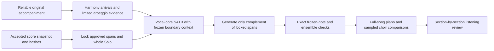

Full-song audition covers 70 source-score measures. Opt-in
`recoverInstrumentalArpeggios` recovers complete, continuous, monotonic source
arpeggios when no explicit block arrival exists; scalar runs are excluded.
This can replace a stale upper structure inherited at a bass-only arrival.
An exposed octave unison stays unison instead of acquiring invented chord tones.
`joinWindowEdges: false` preserves frozen note objects exactly while retaining
common-tone joins inside newly generated regions.

Private review: `tests/private-full-song-review.html`. Baseline manifest and
artifact hashes live in `output/arranger-full-song/`; public source contains no
private score. A is original piano + Solo; B is the prior snapshot (only its
locked excerpts are accepted); C is the full candidate. B/C use identical timbre
choices and full-song loudness normalization. Production defaults and merge
remain unchanged until a separate adoption decision.

The review defaults to **whole song, measures 1–70**, with continuous playback,
eight section choices and two-measure score paging. Piano and sampled choir
share the same notes. A final octave-unison release within one eighth beat of
the barline may close at the barline in the new arrangement; source notes and
all frozen excerpt note objects remain untouched.

## 2026-11-16: two-beat repair with frozen boundary voices

Bobby now reports that the three audition excerpts are essentially satisfactory
except bar 17 beats 3 and 4. Preserve `d99644a` and its private audio as the
user-reviewed baseline. This is acceptance of those excerpts, not the full song.

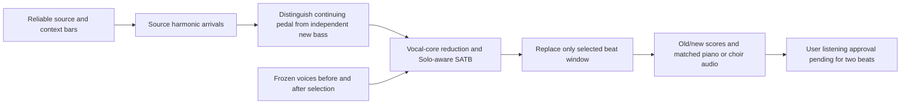

In `vocal-core`, a lone high left-hand arrival no longer inherits the old bass
solely because of register. Retention needs a continuing written pedal or a
left-hand chord block; a bass ending at the arrival is not a continuing pedal.
Legacy `sustained-bass` remains reproducible. This remains a role heuristic.

Optional `editWindow` uses full context for harmonic analysis but replaces only
the selected beats. Frozen incoming/outgoing pitches constrain voicing; common
tones can join at the boundary while an existing reattack outside it survives.
The current private audition selects beats 66 to 68; no song or bar rule exists
inside the shared algorithm. The other reviewed excerpts are not regenerated.

Private page: `tests/private-held-note-review.html`. New piano/choir mixes and
SATB stems are normalized to −23 LUFS. No production default or merge.
See [the arranging method](ACAPPELLA_ARRANGING_METHOD.md) for lessons, counterexamples,
scope of acceptance, and the distinction between bass-relative heuristics and
actual root/function analysis.

## 2026-11-16: quiet vocal-core audition, frozen earlier excerpts

Bobby reported relative improvement in 13–28 but rejected 47–48, while confirming
that source piano A is normal there. New opt-in `harmony: 'vocal-core'` changes
only the later verse. It does not replace the accepted input with inferred chords.

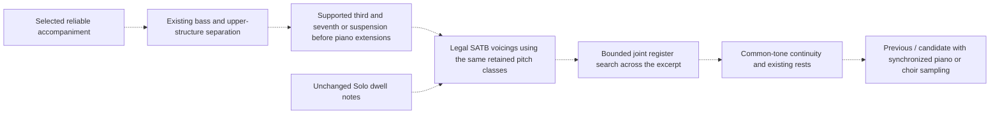

A ninth is optional only when a third plus fifth/seventh, or a suspension/altered
fifth plus seventh, remains. A thirteenth is optional when the third and seventh
remain. Sixth chords without sevenths and unsupported sparse harmony stay intact.
All reductions are logged. These are bass-relative quiet-chant heuristics, not
complete inversion analysis or a universal ban on extensions and dissonance.

`sourceTransfer.ts` can use `melodyPartId` for octave allocation. Repeated attacks
contribute to pitch dwell; fleeting turns do not drive register changes. Sustained
minor-second/minor-ninth conflicts are minimized before movement when the same
chord permits alternatives. A 32-path beam compares the complete selected span;
the historical path retains width-one behavior when melody awareness is absent.
No Solo pitches or retained harmonic pitch classes are rewritten by this search.

Private entry: `tests/private-vocal-core-review.html`, artifacts in
`output/arranger-vocal-core/`. A remains source piano; B/C switch together between
piano and choir samples, with two-bar preview and normalized mix/stem files.
13–28, Solo, ensemble and everything outside 45–52 remain exact. Choir sampling
is not real sung articulation. Musical acceptance remains pending; no merge or
production-default change is authorized by this audition.

## 2026-11-16: legato source-chant diagnostic candidate

Bobby confirmed that A (source piano plus Solo) sounds normal and B/C do not.
The shared beat-pulse candidate below was rejected: stable backing does not mean
all four voices rearticulate together. New opt-in `harmony: 'sustained-bass'`
keeps the existing legato path instead of enabling `phrase-pulse`.


Two reproducible reduction defects were found: high left-hand comping could
replace the bass foundation, and a register-dependent upper-triad preference
could remove a source seventh. The candidate logs comping decisions and all
capacity omissions. An octave-down confirmation on the next beat protects a
real high-register bass approach. Four-or-fewer pitch classes remain intact;
no new pitch classes are supplied. Bass-relative guide-tone priority is a
bounded heuristic, not complete root/inversion recognition.

Private entry: `tests/private-legato-review.html`; output in `output/arranger-legato/`.
Only verses 13–20 and 45–52 change. Solo, ensemble, approved 21–28 and all other
notes remain exact. Original and old auditions remain available. Ten new mix/stem
clips use piano backgrounds at −23 LUFS. Actual engraving is reviewed separately
from tests; there is no direct auditory acceptance. Defaults remain unchanged,
and the arranging branch must not be merged until Bobby accepts it.

## 2026-11-16: phrase-stable chant audition (subsequently rejected)

The previous source chant still varied rhythm too often. New opt-in
`rhythm: 'phrase-pulse'` adds `phraseChant.ts` between harmonic reduction and
SATB allocation. It chooses a shared pulse over at least four measures, based
on the whole-beat harmonic arrivals of that block. Source harmony and bass
arrivals remain unchanged; a real off-grid change is an explicit exception.

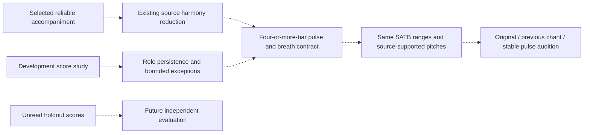

A pulse can be one bar, half a bar, or one beat, selected from source constraints;
there is no borrowed reference-song cell. Common tones now rearticulate on the
same clock. Breathing repeats at a tempo-dependent interval; it never deletes
an entire short harmonic arrival. Source silence overrides the pulse. This is a
quiet chant policy, not a general arrangement model or a musical acceptance claim.
It may sound too regular; more repeated notes is an intentional tradeoff to test.

Private entry: `tests/private-phrase-chant-review.html`; artifacts in
`output/arranger-phrase-chant/`. Only the two verse excerpts change; Solo, ensemble,
approved 21–28 and all old auditions stay intact. Production defaults and PRs
remain unchanged. Study scope and curriculum: [audition learning](ARRANGEMENT_AUDITION_LEARNINGS.md).

## 2026-11-16: source harmony chant, not piano-note transfer

Bobby rejected literal transfer of piano figures into all four voices. The new
opt-in `sourceChant.ts` separates harmonic arrivals from instrumental events.
It uses the explicitly selected accompaniment/bass staves and the previous MIDI
notation preprocessing. Solo never supplies replacement harmony.

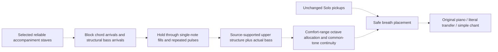

New sustained blocks and on-beat bass landmarks can change harmony; a single-note
fill or octave-up bass figure does not automatically do so. Repeated pulses that
omit a member preserve the previous source harmony. This is an explicit reduction
heuristic, not proven chord/function recognition. Above four pitch classes, prefer
a triad already present in the upper structure plus bass, with a preference against
extra seconds above bass when alternatives exist. Log all omitted colors; do not
invent pitches or call the result an exact copy of every original chord color.

SATB ranges for this audition are E4–E5, A3–A4, D3–E4, E2–G3. Common tones can
continue, but source silence and breaths break them. A Solo pickup after a gap can
lead into a shared downbeat restart. Continuous humming has a two-measure breath
budget; placement must leave a genuine short harmonic event audible, rather than
erase it with a rest. There are no note-count quotas or song/bar-specific rules.

Only the two verse excerpts change. Solo, ensemble and accepted excerpt remain
exact. Private review: `tests/private-source-chant-review.html`. Formal defaults,
old candidates and unmerged arranging PRs are unchanged; Bobby listening pending.

## 2026-11-16: literal source accompaniment transfer audition

Bobby rejected the harmonic-interpretation audition. PR #58 remains unmerged.
The new opt-in `sourceTransfer.ts` bypasses chord naming and `jointVoicing`.
Selected accompaniment staves, not Solo or generated backgrounds, supply every
pitch class. Actual note starts and releases delimit the source sonorities.

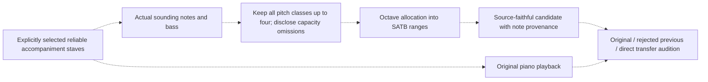

The actual lowest sounding source pitch class stays in Bass. All source pitch
classes are required when there are at most four. With more than four, retain
the lowest pitch and the highest remaining distinct classes; explicitly report
omissions. This is a deterministic capacity reduction, not harmonic importance
analysis. Motion/register preferences can choose octaves but cannot add tones.
No extension through source silence, no invented breaths, no Solo-led correction.
Source figures and reattacks remain; this is not yet a complete vocal arrangement.
An optional, logged preprocessing step makes tightly staggered ascending,
overlapping MIDI rolled chords simultaneous. It is an inference, not literal
timing preservation, and is off by default.

Another default-off, logged reduction recognizes isolated very short on-beat
MIDI attacks immediately followed by a sustained event as possible performed
grace notes. It omits that ornament only from the backing reduction and moves the
main event to the beat. It does not remove short runs. Original playback retains
all ornaments; this inference still needs listening review.

Private audition enables both MIDI notation options, retains Solo and the approved excerpt,
and changes only the two verse excerpts. A is original piano plus the same Solo;
B is the rejected interpretation; C is direct allocation. Production default is
unchanged. Private entry: `tests/private-source-transfer-review.html`.

## 2026-11-16: explicit harmonic interpretation before chant voicing

Bobby still rejects the harmony in the previous candidates. `harmonicPlan.ts` is
an opt-in interpretation layer, not another accepted arranging baseline. It keeps
root distinct from bass, enumerates a bounded tonal chord vocabulary, and reports
core tones, optional colors, excluded tones, alternative interpretations and review
reasons. A named candidate does not establish musical correctness.

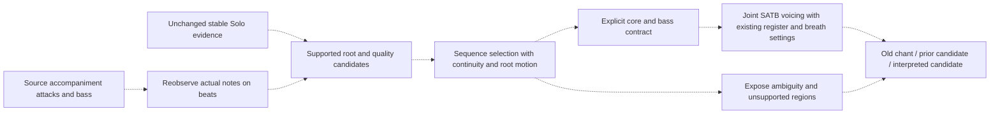

The source adapter can retain dyads for interpretation instead of discarding them.
It no longer treats all notes later in a held guide as available at its start.
Only one missing core tone may be inferred from an adjacent same-bass candidate,
with no conflicting new evidence and no chain of inherited omissions. Optional
colors are not carried by that rule. Such inferences remain review items. Possible
passing/neighbor/suspension labels are local timing heuristics, not verified voice
analysis. Ambiguous choices use a bounded dynamic-programming path, not a trained
harmonic model or globally complete tonal analysis.

The voicer must retain the interpreted core when all four backing voices sound;
range/smoothness scores cannot trade it away. Unsupported regions retain the prior
candidate with explicit review evidence rather than becoming artificial silence.
The two verse excerpts are regenerated. Solo, ensemble, and accepted excerpt are
unchanged; defaults remain legacy. Private review: `tests/private-harmonic-plan-review.html`.

## 2026-11-16: chant structure, Solo pickups and register audition

Bobby reports that simple chant is substantially better, but identifies remaining
harmonic, phrase-boundary and register problems. This is partial acceptance only.
Two opt-in comparisons retain the previous chant: B adds source-structure costs and
Solo-informed breaths; C additionally changes register preferences. Production
defaults and the accepted excerpt are unchanged. This does not demonstrate that
the new algorithm would regenerate the accepted excerpt equally well.

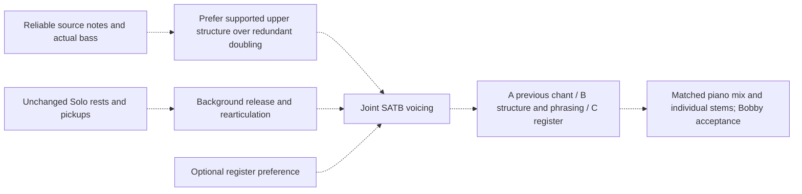

The structure option never adds a pitch absent from source harmony. It penalizes
redundant bass/upper doubling, retains supported third/seventh intervals relative
to the actual bass, and favors a supported upper triad. These are soft heuristics,
not a definitive chord analysis, especially with inversions or ambiguous palettes.
Solo gaps of at least half a beat can release the background; a late pickup can
lead into a shared beat restart instead of an automatic common-tone tie.

Private entry: `tests/private-chant-refine-review.html` on existing 5174. Twenty
new piano mix/stem clips are matched to −23 LUFS (maximum deviation 0.03 LU).
Both rewritten excerpts were visually reviewed in B and C. Default replay, Solo
and untouched regions match their saved baseline. Twenty focused tests and
TypeScript pass. Audio playback validation is not listening acceptance.

## 2026-11-16: plain chord chant, following rejection of melodic backgrounds

Bobby rejected the rebuild: repeated verse melodies received unnecessarily complex
background lines. `chordChant.ts` is a deliberately simpler opt-in path. It bypasses
foundation/motif/dialogue planning entirely, sustains source-supported harmony with
Hmm, and uses joint voicing only to connect those sustained voices. Source events
shorter than one beat are omitted from this reduction, leaving explicit gaps;
continuous regions have a shared half-beat breath after at most two bars. This is
a limited harmonic chant candidate, not a claim of skilled full-song arranging.

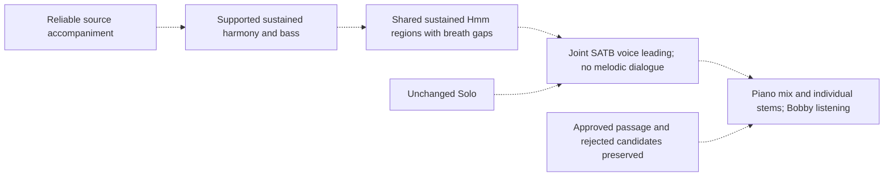

The voicer starts independently of prior experimental background notes. Identical
source/Solo passages at different locations produce the same chant; this is not a
fuzzy repeated-section detector. Actual accompaniment differences can change voicing.
Only the two rejected verse excerpts are regenerated; the accepted excerpt, Solo
and ensemble are unchanged. No song title, bar-specific notes or reference template
enters the algorithm. Source extraction and joint-voicing heuristics still apply.

Private entry: `tests/private-chant-review.html`, existing 5174 service. A is the
partially accepted original, B the rejected rebuild, C plain chant. Ten new mix/stem
clips use piano backing and static-gain loudness matching. All 16 rewritten bars
were visually inspected. Eighteen focused tests and TypeScript pass; these do not
constitute listening acceptance. Production defaults are unchanged.

## 2026-11-16: rebuild from the partially accepted joint-voicing implementation

Bobby rejected the subsequent anchor/structural-voicing experiments (#52/#53).
This branch starts at `15e1a5b`, not those experiments. Replaying the original
joint-voicing implementation against the saved input reproduces its parts exactly.
The accepted bars 21 to 28 are frozen in the private audition; this is preservation,
not evidence that the new algorithm passes that region. Only 13 to 20 and 45 to 52
are regenerated. Solo and ensemble remain identical.

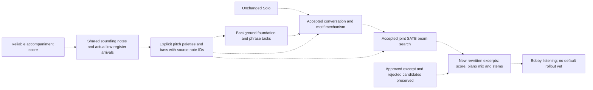

`sourceHarmony.ts` reduces a voiced accompaniment, without completing guessed
chord names with unheard thirds. Rolled arrivals and held common tones contribute;
Solo ornaments do not. `sourceArrangement.ts` supplies the same context to the
foundation, dialogue planner and joint realization. Previously, an override could
reach pitch selection while foundation planning still read old project chords.
All rewritten excerpts use the accepted conversation path; section labels no longer
raise the background register through `lift`. The joint voicer's default path and
weights remain unchanged. With explicit source palettes it skips guessed-scale
passing tones and root-relative third/seventh completion.

This is an opt-in experimental composition path. It changes background pitches and
rhythms; it is not a pitch-only A/B. The half-beat arrival grid, chordal-part selection,
low-register heuristic and two-bar maximum context are limitations, not general
musical truth. Unvoiced regions can remain evidence gaps. The implementation is
oriented to reliable block/rolled accompaniment; it does not replace audio inference.
No reference arrangement, song title or bar-specific pitch rule enters generation.

Private review: `tests/private-rebuild-review.html` on the existing 5174 server.
A is the version containing the approved passage, B the rejected anchor experiment,
C the rebuild. C's protected passage reuses A's score notes and audio exactly.
Ten newly rendered piano clips (mix plus SATB for each rewritten excerpt) use static
gain to -23 LUFS, measured within 0.02 LU. Solo timbre, tempo and mix settings stay
fixed. Stem normalization is independent and does not represent mix balance.
All 16 rewritten bars were visually inspected in-browser; 25 relevant tests and
TypeScript pass. No direct listening acceptance is claimed. Private input, rendered
scores, clips, feedback, provenance and scripts remain local, never in Git.

## 2026-11-16: listening feedback and selectable background audition timbre

Bobby gave positive listening feedback on joint-voicing bars 21 to 28, but rejected
17/18 and all of 45 to 52. This is partial acceptance, not whole-arrangement quality.
See [audition learnings](ARRANGEMENT_AUDITION_LEARNINGS.md) for observations,
counterexamples and the next harmonic-segmentation hypothesis.

This iteration changes timbre only. `auditionTimbre.ts` builds a non-mutating
playback view: vocal harmony/bass defaults to piano, with an original-timbre option.
Musical Solo, source instruments and percussion remain unchanged. The App uses the
view for score playback, sample priming and note audition; written instruments and
exports retain the project data. Transport controls pause before changing timbre.

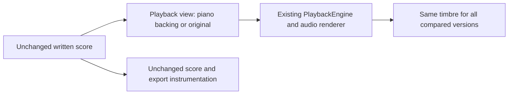

The private joint review defaults to piano and retains the original audio option.
Forty-five new piano clips use static gain to -23 LUFS within 0.04 LU; all forty-five
original clips and score hashes are unchanged. Eight playback/timbre tests and the
TypeScript check pass. Production TransportBar was exercised in an isolated browser
harness at desktop and narrow width; this does not claim a production deployment.
The new App playback control is on the audition branch, not canonical main.

## 2026-11-16: isolated joint-voicing audition

The next controlled layer realizes the four background voices together, using the
previous harmonic hypotheses and rhythmic gestures. `jointVoicing.ts` performs a
bounded beam search over simultaneous sounding notes, with whole-duration costs for
spacing, close dissonance, missing chord identity and Solo collision. Bass arrivals
follow the supplied root or slash bass; short prepared/resolved connections remain
possible. Existing contours and smooth transitions are soft preferences.

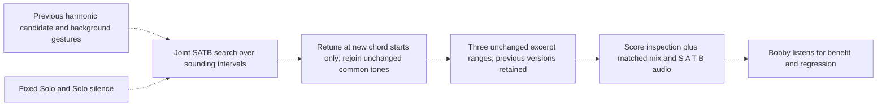

Solo, ensemble, chord hypotheses, tempo, samples, mix settings and sounding coverage
remain unchanged. Background pitches may change; a held note may turn at a new chord
start, but an annotation ending without a new chord is not permission to reset its
pitch. Common-tone pieces are rejoined. No song, bar or reference-score exceptions
are embedded in the solver. Only bars 13 to 20, 21 to 28 and 45 to 52 are auditioned.

The reported bars 27/28 illustrate the defect: the previous bass held D through an
Am9 segment, while an upper neighbor introduced Bb. The candidate moves the bass to
A at the supplied Am9 boundary and removes the unsupported chromatic neighbor.
This is a structural diagnosis, not proof that the inherited harmony or arrangement
is musically correct. Bars 21/22 have five changed background events and require an
explicit regression listen; they are not hard-coded or claimed preserved in quality.

Private review: `tests/private-joint-review.html` on port 5174. It retains the earlier
dialogue and previous harmonic versions, offers mixes and each background voice,
and displays source-score images. Fifteen new clips and thirty unchanged old clips
measure -23 LUFS within 0.03 LU. Stem normalization is independent and does not
represent full-mix balance. The 24 candidate bars were visually inspected; 76 related
tests and TypeScript checking passed. Listening acceptance remains Bobby's task.

This is an isolated heuristic candidate, not the production default. Harmony remains
unverified; original rhythmic gestures and sample articulation still limit quality.
Nine previously read reference arrangements remain development material, not holdout.

## 2026-11-15: isolated harmonic-evidence audition

Bobby reported that the dialogue candidate was pleasant around bars 21 and 22 but
inconsistent elsewhere. The first controlled experiment changes harmonic evidence
only. It does not claim that the entire arrangement is improved or accepted.

`harmonyEvidence.ts` excludes the selected Solo and percussion, integrates the
accompaniment's sounding pitch classes and lowest notes, and pools broken-chord
members across segments. Its hypotheses include sixths, added ninths and ninths,
with possible inversions. A bounded approximate segment search penalizes unsupported
changes; actual silent evidence gaps remain unassigned. This is rule-based harmonic
analysis, not a trained model or a calibrated confidence estimate. Per-beat alternatives
are diagnostics, not the same objective as the pooled segment decision.

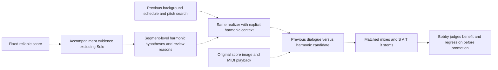

`createMelodicDialogue` accepts an optional harmonic context without changing its
schedule, seed material or default behavior. The experiment preserves Solo, ensemble,
all attacks, durations, syllables, velocities, tempo, samples and mix. Only background
pitches and displayed harmonic hypotheses change inside bars 13 to 20, 21 to 28 and
45 to 52. Bars 21 and 22 are a regression case, not a song-specific exception.
All other notes retain the previous candidate. No reference arrangement is read by
the generator; the nine studied arrangements remain development material.

Private review: `tests/private-harmony-review.html` on port 5174. It offers the
original hand-transcribed score's MIDI playback, unchanged previous dialogue and new
candidate, with expandable source-score images. The reference uses its original
instrumentation and is not the equal-timbre arrangement A/B. Eighteen new audio files
and fifteen unchanged previous files are available: all 33 measure -23 LUFS within
0.01 LU. Stem gains are independent diagnostic gains, not the full-mix balance.

The 24 candidate bars were visually inspected. Sixty-nine related synthetic tests
and TypeScript checking passed; private assertions verify exact Solo, schedule and
outside-span notes, plus hashes of retained audio. These checks do not establish
harmonic correctness, singability or hearing acceptance.

Known limitation: the fixed sequential pitch search can still choose an unsuitable
bass or keep a long note across a harmony change. A better chord hypothesis does not
guarantee that the generated vertical voicing realizes it. Joint voice realization,
whole-duration dissonance handling and phrase-level musical judgment remain later,
separate layers. The default production generator is unchanged.

## 2026-11-15: melodic dialogue audition and vocal tenor clef

Bobby found the bounded ensemble sketches still sounded like chord padding. This
revision remains an audition, not an accepted or production arrangement. Solo and
Solo+SATB stay fixed; flexible divisions such as SSATTB are a future requirement,
not a reason to silently change this comparison's ensemble.

`melodicDialogue.ts` extracts one short moving cell from stable Solo notes, retains
its rhythmic/contour identity across phrase windows, and assigns statement,
imitation or contrary answer, phrase-end Solo harmony and harmonic support to
different singers. Bass connects actual harmonic destinations. Horizontal pitch
search balances contour with range, chord context, collisions and voice ordering;
chromatic connections need evidence in the input melody or current chord. The
composed Solo harmony is not a transcription of original backing vocals.

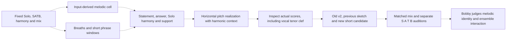

Only bars 13 to 20, 21 to 28 and 45 to 52 are rewritten. All other bars remain the
previous candidate. The private review page retains existing audio unchanged and
adds 15 new renders. Each excerpt offers a full mix and four background stems.
Post-render normalization uses static gain to the same -23 LUFS target; individually
normalized stems are diagnostic, not the balance heard in the full mix.

Reference study revisited development scores for imitative handoff, moving inner
parts and distinct bass arrivals. No reference notes enter generation. All nine
already-read scores remain development material, not an unseen holdout set.
The 24 newly arranged bars were visually inspected. Automated checks protect Solo,
outside-span notes, ensemble and octave semantics; listening approval remains Bobby's.

The separate tenor correction adds `treble8`: ABC displays the written octave and
compensates playback; MusicXML keeps sounding pitches with clef-octave-change -1;
MIDI stays unchanged. New arrangeV2 tenor parts use this clef. Existing projects can
select it in the inspector, without forced migration of saved notes.

Limitations: source harmony is inherited and unverified; phonetic playback uses
choir samples; role scheduling and motif development remain rule-based and may
still feel repetitive. No claim of learned arrangement competence or listening
acceptance. The default arrangement algorithm is unchanged apart from tenor clef.

## 2026-11-15: bounded ensemble sketches after continuity rejection

Bobby rejected the continuity candidate: some singers had no meaningful contribution
for long stretches. Its Alto had only 12 notes. Tests and the earlier score inspection
did not establish musical acceptance. Do not promote that candidate as an accepted baseline.

`ensembleSketch.ts` is an audition-only, bounded rewrite of an existing Solo+SATB
project. Three explicit musical intentions (flow, conversation, lift) guide group
gestures from harmonic arrivals and Solo phrase evidence. A joint voicing search
considers horizontal movement, spacing, pitch-class coverage and Solo collisions.
Common tones can continue; phrase-end gaps can release the group. There is no
per-singer attendance quota, song-name dispatch or reference-note input.

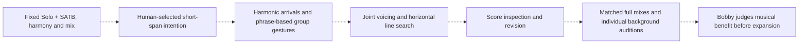

The experiment retains old v2 and rejected continuity output. It changes background
pitches, rhythms and syllable allocation together as a musical-sketch layer; this is
not a rhythm-only ablation. Solo, ensemble, source harmony, tempo, samples and part
mix stay fixed. Only three eight-bar spans are newly arranged. Other bars in the
private project remain the rejected candidate, not a new complete arrangement.

Five synthetic tests and TypeScript checking passed. The 24 excerpt bars were
visually inspected in the actual review page; the first draft's missing cadence
breaths were revised and rerendered. The private audition has 45 selections:
43 non-silent clips at -23 LUFS within 0.03 LU and two explicitly marked silent old
stems. Same renderer as earlier comparisons; normalization applies static gain
after that shared rendering chain. Individual stems are normalized for diagnosis,
not to represent their level inside the mix. No direct hearing acceptance is claimed.

Limitations: high-level intentions are manually selected, source harmony is inherited
and unverified, flow remains simple, phonetic playback uses choir samples, and
motivic development is still rudimentary. The production generator is unchanged.

## 2026-11-15: cross-phrase background continuity (personal-computer candidate, subsequently rejected)

One rhythm/participation layer, after the earlier phrase candidate. The default
Solo+SATB generator remains unchanged until Bobby reviews the audition.


- `planBackgroundContinuity` builds a complete-song timeline before section
  rendering. Short Solo breaths do not restart motifs; long silence or a changed
  motion policy begins another episode. Identical rhythm motifs can recur.
- Motifs come from the input melody, never a reference-score template or song
  name. Upper-voice tasks use register clearance; support can enter after the
  first phrase, and responses occupy actual Solo gaps. Bass retains its own
  harmonic landmarks. This is a deterministic candidate, not a trained model.
- Generated backgrounds use a half-beat clock. A sixteenth Solo pickup must not
  permanently offset a repeated background and cause short chord-edge pieces.
  Solo itself is not quantized or edited by this layer.
- Frozen comparison: old v2, previous phrase candidate, new continuity candidate;
  same input, Solo, Solo+SATB, harmony, plan, pitch allocator, syllable mapping,
  tempo, sample renderer and part mix. Private files stay outside Git.
- Limits: the existing section plan still uses heuristic eight-bar blocks;
  chord-boundary articulation, independent pitch-line development and phonetic
  rendering are not redesigned here. Static constraints are not musical approval.
  All nine newly studied references are development material, not blind holdouts.


## 2026-11-15: OMR text layer v8 — chord fix on D3, third confirmation test C3 (still off by default)

Text layer only; notes still never edited. v8 (`5152bdf`) was developed on a new dev set D3 and frozen by file hash; C3 is fresh public data with the C2 gates unchanged, written before any C3 item was opened, run once. C2 was not used for tuning.

- **D3 (development only).** 40 further OpenEWLD lead sheets (crc32 positions 91–130), clean and simulated photo. Changes kept: wider chord spellings (Maj7, MA7, -7, 7+, 7#5, 7(b9), 7sus, m9, °7 …, mapped to MusicXML kinds); chords printed glued together ("D7/F#A7/E") are split and placed by character position; the whole gap between two systems is also the lower system's chord zone; the OCR extractor no longer crashes on RapidOCR's empty placeholder lines. D3 chords .858 → .876 clean, .855 → .876 photo; lyrics unchanged. Not tuned: Verovio draws ♭/♯ inside chord names in its music font, which OCR misses; printed lead sheets mostly use text b/#.
- **C3 result.**

  | Gate | Result | |
  |---|---|---|
  | Notes unchanged | 117 / 117 pages | pass |
  | 40 new lead sheets, clean: lyrics, chords ≥ .85 and ≥ Audiveris | .894, .860 (Audiveris .791, .680) | pass |
  | Same, simulated photo: ≥ .70 and ≥ Audiveris | .771, .825 (Audiveris .433, .324) | pass |
  | 25 OpenScore Lieder (train split) re-rendered: verse-1 sequence F ≥ .75 and ≥ Audiveris | .922 (Audiveris .696) | pass |
  | 12 new SLUB scans: failure ≤ 15 %; instrumental pages ≥ 80 % with no false lyric, ≤ 2 per page | 0 / 12 failed; 4 / 6 instrumental pages clean (.667), 0.5 per page | **fail** |
  | Vocal scan pages with no lyrics ≤ 20 % | 0 / 6 | pass |
  | Kong Er: 268 syllables in verse 1, OCR agrees ≥ .95, part names on all pages | 268, .992, all 人声 / 钢琴 / 弦乐合奏 | pass |

  The three false lyrics were performance marks printed under keyboard staves of two sonata scans: "Poc" and "P" (poco, p) and "dol" (dolce). Two oversize scans were shrunk to Coro's 3500-pixel upload limit before recognition, the same rule the upload path applies; this is recorded in the protocol.
- **Decision.** One gate failed, so the layer stays an off-by-default experiment, with chord symbols now passing on fresh data. C3 is not used for tuning. Real phone photos remain unmeasured until Bobby takes them.
## 2026-11-15: OMR review data for the side-by-side editor (review layer)

Implements the interface decision of 2026-11-15. The score itself is unchanged; this layer only describes where it sits on the pages.

- **What the server writes.** Each recognized `<note>` gets `id="omr-{page}-{k}"` (on a copy; homr's raw page MusicXML stays as written). `OmrJob.review` carries page sizes, staff boxes, measure boxes, approximate note anchors and review issues; it is also saved as `review.json` in the job folder.
- **Measure boxes.** Boundaries start halfway between neighbouring measures' note anchors and snap to an ink column that crosses the staff lines of most staves of the system (a barline, not a stem). Edges that found one are `barline`; the first and last edge of every system stay `estimated`.
- **System ends (2026-11-15, later).** The last edge of a system now snaps to the barline that closes it (rightmost ink column right of the last note, within three staff spaces of the staff's or the system's typical box end, so a final double bar closes on its thick stroke); the first edge snaps to the system barline when one is printed (multi-staff systems), else stays `estimated`. Full upload path: public two pages 42 → 47 of 52 edges on barlines (the 5 left are single-staff system starts, which print no barline); Kong Er pages 1–6 66 → 138 of 144. Visual check on these and on 9 SLUB scans (overlays kept locally): closing edges sit on the printed line; scan edges on barlines 308 → 391 of 503 per side across all 17 pages. Still estimated: interior edges next to whole-bar rests, faint or broken scanned barlines (a choral page keeps 25 of 55), and one skewed Bach fugue scan where no column crosses the staves at all.
- **Issues (no confidence scores).** `measure-overfull` / `measure-underfull` (beats read vs. meter, with a note that pick-ups and repeat halves are legitimate), `no-anchor`, `page-part-mismatch`, and, when the text layer runs, `text-discarded` (check) and `text-attached` (info) from its evidence.
- **Measured.** Two public pages (tests/fixtures/omr-review): 112/112 notes anchored, 42 of 52 edges on barlines, the 10 estimated ones are system ends, four real underfull bars (pick-up, repeat halves, last bar). Kong Er pages 1–6 (private, local check only): 604/604 notes anchored; 66 of 72 inner edges on barlines, all 72 system-end edges estimated; one underfull bar.
- Anchors are attention centres, often half to two staff spaces off the note head; the editor must say so.


## 2026-11-15: OMR text layer v7 — second confirmation test C2 (still off by default)

Text layer only; notes still never edited. v7 (PR #28, `03cd055`) was developed on a new dev set D2 and frozen; C2 is fresh public data, rules written before any of it was opened, run once.

- **D2 (development only).** OpenScore Lieder dev pages, 25 new SLUB Dresden scans (11 instrumental / 14 vocal, labelled from thumbnails before recognition), 4 quartet pages, plus the earlier lead-sheet set for regression. Changes kept: no lyrics under a keyboard grand staff; a lyric row must follow its staff's note onsets (a few words over many onsets is a caption; rows of mostly numbers are footnotes; a lone letter is a misread mark unless it is a common one-letter word); words run together in the image are cut at note positions, only before a capital or after punctuation. Rejected: re-splitting OCR words at ink gaps (lead sheets .892 → .800). Found: the LilyPond page images in `zzsi/openscore` print words of a lyric line without spaces, a rendering defect, so C1's art-song item mostly measured that; C2 re-renders the same reference MusicXML with Verovio and keeps the LilyPond images as an ungated stress test.
- **C2 result.**

  | Gate | Result | |
  |---|---|---|
  | Notes unchanged | 129 / 129 pages | pass |
  | 30 new lead sheets, clean: lyrics, chords ≥ .85 and ≥ Audiveris | .881, **.837** (Audiveris .683, .610) | **fail** |
  | Same, simulated photo: ≥ .70 and ≥ Audiveris | .773, .823 (Audiveris .336, .270) | pass |
  | 25 OpenScore Lieder (test split) re-rendered: verse-1 sequence F ≥ .75 and ≥ Audiveris | .821 (Audiveris .547) | pass |
  | 12 new SLUB scans + 8 orchestra pages: failure ≤ 15 %; instrumental pages ≥ 80 % with no false lyric, ≤ 2 per page | 1 / 20 failed; only 50 % clean, 8.75 per page | **fail** |
  | Vocal scan pages with no lyrics ≤ 20 % | 0 / 11 | pass |
  | Kong Er: 268 syllables in verse 1, OCR agrees ≥ .95, part names on all pages | 268, .992, all 人声 / 钢琴 / 弦乐合奏 | pass |
  | Stress test, LilyPond art-song images (no gate) | .379 | — |

  False lyrics on instrumental pages came from a piano method's prose paragraph (52 syllables), a chorale book's hymn titles (14) and the orchestral "a 2" mark (4). Four orchestra pages (Bach B-minor Mass) print choral lyrics; they were relabelled vocal after recognition had run, and this is recorded.
- **Decision.** Two gates failed, so the layer stays an off-by-default experiment. C2 is not used for tuning. Next: chords on a new dev set D3 and a fresh confirmation C3. New real phone photos remain unmeasured until Bobby takes them.

## 2026-11-14 evening: OMR text layer — lyrics, chord symbols, part names (text layer, experimental, off by default)

One layer added on top of homr; homr's notes are never edited (checked per page, before/after identical on every test page, otherwise that page's text is dropped).

- **What it does.** Per page: homr's staff boxes (`--write-staff-positions`, mapped back through homr's own autocrop) and note positions (`imgpos`) define zones. Text boxes come from the PDF's own text layer when the page has one, otherwise from RapidOCR (PP-OCRv6, bundled with homr, offline). Below a staff → lyric syllables aligned to sung notes by x; above → chord symbols (strict regex) or section words; left margin → part name. Raw per-page homr MusicXML, the text-layer page and `text-evidence.json` (every box: attached where, or why discarded) are all kept.
- **Evaluation (rules written first; private `work/omr-20261114/PROTOCOL-text.md`).** Public pages only: 30 public-domain OpenEWLD lead sheets rendered by Verovio (10 held out) and the 8 Sheetly benchmark pieces with lyrics, clean and simulated photo; reference = the source MusicXML. Strict match: same bar, onset within 1/16 beat, verse number, text.
  - Pre-registered version (v4) on the held-out set: lyrics F clean .916 / photo .773, chords .904 / .606; Audiveris `read_text` .811 / .538 and .628 / .340. It failed the Kong Er check: 36 of 268 syllables were put in verse 2 because the engraver lowered single syllables under low notes.
  - **Shipped version (v6) is a post-hoc fix**, so its held-out numbers are reference only: lyrics clean .916 / photo .789, chords .904 / .883; Sheetly 8 lyrics .738 / .621. Changes: verse numbers by x-overlap packing; staff boxes mapped back through homr's autocrop; staff groups chosen by homr's note positions (a piano-only intro system no longer breaks the page); performance terms (pizz., a tempo …) are not lyrics.
  - Kong Er (private, reference = the PDF's own text): 268 syllables, all verse 1; OCR route agrees syllable by syllable .985 clean / .945 simulated photo; part names 人声 / 钢琴 / 弦乐合奏 on all 19 pages.
  - Real phone photos (sheet-music-photos, CC0, one vocal page × 8 photos, relative to the same page's scan): verse-1 text sequence agreement .42–.98, two tilted/background photos below .5. On instrumental pages a few stray words (footer, "NOTE") are still read as lyrics.
- **Confirmation test C1 (frozen code, new data, one run; rules written before the data was opened).**

  | Gate | Result | |
  |---|---|---|
  | Notes unchanged on every page | 189 / 189 | pass |
  | 30 new lead sheets, clean: lyrics, chords ≥ .85 and ≥ Audiveris | .878, .860 (Audiveris .729, .615) | pass |
  | Same, simulated photo: ≥ .70 and ≥ Audiveris | .857, .855 (Audiveris .333, .285) | pass |
  | 20 OpenScore Lieder pages (LilyPond engraving): lyric sequence F ≥ .75 | .353 (Audiveris .316) | **fail** |
  | 109 real 1805–1929 scans: failure rate ≤ 15 %; instrumental pages ≥ 70 % with no false lyric, ≤ 3 per page | 0 failures; only 14 % clean, 9.8 false syllables per page (pedal marks, copyright lines, instrument names, ornaments read as CJK) | **fail** |
  | Kong Er: 268 syllables in verse 1, OCR agrees ≥ .95, part names on all 19 pages | 268, .985, all 人声 / 钢琴 / 弦乐合奏 | pass |

  New real phone photos were not available (the public set's 24 photos had been used), so real-photo accuracy is still unmeasured.
- **Shipped as an experiment, off by default.** `text_layer=false` unless the import dialog's experimental box is ticked. When on, imported projects keep lyrics (verse 1), chord symbols and part names (also written as `part-abbreviation`, so later systems keep the name) through Coro's normal MusicXML import.
- **Kong Er checks.** The PDF prints no chord symbols and no tempo (65 BPM exists only in the MIDI), so the missing chords and the default 100 BPM are not recognition losses; the later-system "P1" label was an import fallback and is fixed by the abbreviation.
- **Not done.** A fresh untouched test set for a clean confirmation; Chinese jianpu; rehearsal marks/repeat words are written as `<words>` only and are not used downstream.

## 2026-11-14: score input — homr becomes the default OMR engine (recognition layer)

One layer changed: which recognizer reads PDF/images. Raw output of every engine is kept; Audiveris stays installed and selectable.

- **Pre-registered A/B.** Rules were written before any run (private `work/omr-20261114/PROTOCOL.md`).
  - Public pages: the 31 Sheetly OMR benchmark pages (CC BY 4.0) in four conditions: clean render (~242 dpi), half-resolution (~121 dpi), simulated scan (tilt ±1.5°, blur, noise, JPEG), and the benchmark's own simulated phone photo.
  - Metric: the benchmark's strict F1 (pitch, onset in bar and duration all right, page 1). Our run of its scorer on its published Audiveris files reproduces 88.43 / 50.43.
  - Fixed 11-piece TEST split (`crc32(slug) % 3 == 0`), run once; any rule tuning only on the other 20.
- **Result, strict F1 on TEST (all 31 in brackets).**

  | Condition | Audiveris 5.11 (current) | homr 72fdfa8 | copisteria 1.3.4 |
  |---|---:|---:|---:|
  | clean | 79.3 (87.6) | **97.3 (96.7)** | 96.1 (96.0) |
  | half resolution | 74.9 (82.3) | **97.7 (96.9)** | 96.1 (96.1) |
  | simulated scan | 73.4 (83.8) | **97.4 (97.3)** | 95.9 (95.7) |
  | simulated photo | 26.9 (32.5) | **97.2 (96.7)** | 73.7 (71.4) |
  | pieces with no output (all 31) | 1 / 1 / 1 / 16 | 0 | 0 |

- **Same Kong Er ruler as 2026-11-13** (bars 1–70, same pitch on the same sixteenth; all parts, lead in brackets):
  - Audiveris: PDF .880 (.967), half-res .798, scan .723, photo 0 (rejected as "several movements").
  - homr: PDF through Coro's real `recognize()` .901 (.995); half-res .897, scan .901, photo .897 (.955).
  - These are still synthetic degradations of a vector export. Real phone photos, real scans, handwriting and jianpu are not measured.
- **Shipped.** `engine` = `auto` (default: homr, falls back to Audiveris only when homr returns nothing) / `homr` / `audiveris`.
  - homr runs as a separate AGPL process from `models/omr/homr` (`scripts/setup-omr-homr.sh`), pinned commit, SHA256-checked weights, private HOME and blocked proxies.
  - Per-page raw MusicXML is kept in the job folder; pages are merged with homr's own page joiner. Different part counts across pages are reported, not hidden.
  - Old requests without `engine` keep using Audiveris.
- **Rejected / not shipped.**
  - copisteria: weaker on photos and on Kong Er scan/photo; kept as a candidate.
  - Measure-level fusion (take the other engine's bar when homr's bar does not fill its meter): +0.7 clean, −0.6 scan, −2.5 photo on DEV, so it never reached TEST.
  - Cross-engine disagreement as a confidence score: on TEST, bars where homr and Audiveris agree were still wrong 2–10% of the time, so it is not a confidence. Not shown as one.
- **Known gaps of homr.** No lyrics, chord symbols or part names (0 in every output); about 0.7 of the reference's ties; parts named Voice/Piano. Audiveris remains the choice when you want it to try lyrics.
- Test pass and these scores are not musical acceptance. Compare against the source page before rehearsal.

## 2026-11-15: score input and editor status

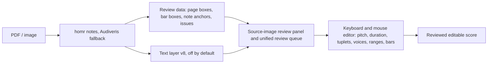

- **Production:** homr OMR; experimental text layer v8 (off by default); per-note
  `sourceRef` and `source.omrReview`; source-image review panel with two-way
  jumps; one review queue filtered by reason.
- **Editor layers merged:** keyboard proof-reading (#27), source review (#31),
  range select/copy/paste and voices 1-4 (#33), tuplets and onset repair (#34),
  mouse note entry (#36), insert/delete bars (#37).
- **Verified:** a formal homr upload of Kong Er pages 1-6 mapped 604/604 notes to
  the page; clicking a score note opened the matching page region, and `]`
  moved to the next review item.
- **Open:** bar edges at the start and end of each line are estimated. The text
  layer failed its confirmation tests on instrumental scan pages (performance
  terms read as lyrics). Real phone photos remain untested.

## 2026-11-14: work-computer priority moves to score input and editing

Bobby's listening review: none of the first Solo + SATB drafts is yet a
qualified a cappella arrangement. Arrangement work moves to his personal
computer, where more reference arrangements are available. This computer now
focuses on reliable score input and an efficient correction/editor workflow.


- **Production now:** homr is the default PDF/image engine; Audiveris remains an
  explicit choice and automatic fallback.
- **OMR session:** next layers are text/structure, real-photo and real-scan
  evaluation, then page-region mapping for correction.
- **Editor session:** study Crescendo's interaction model with REA and direct
  use, then independently implement high-value input, selection and correction
  workflows in Coro. Do not copy proprietary code or assets.
- **Arranger:** `solo-satb` remains available for comparison, but it is not
  accepted as a qualified arrangement and is not active work on this computer.

## 2026-11-14: arranger v2 first listening draft

Layers changed one at a time: input normalization, then arrangement.

```mermaid
flowchart TD
  IN[MusicXML / MIDI / OMR score] --> NORM[Input normalization: MIDI notation gate restore]
  NORM --> SRC[Source score: lead, chords, optional bass]
  SRC --> PLAN[Section plan: rule or model]
  PLAN --> SOLO[Solo locked: pitch, onset, duration, lyric unchanged]
  PLAN --> SATB[S/A/T skeleton by chord slot]
  PLAN --> BASS[Bass role: sustain, pulse or groove]
  SOLO --> CHECK[Score validation, rendered score and synthetic playback]
  SATB --> CHECK
  BASS --> CHECK
  CHECK --> REVIEW[Human score reading and listening]
```

- **MIDI input.** `fromMidi` now restores written durations only when one export
  gate dominates the file. A free-length control is unchanged. On two local
  Crescendo exports, MusicXML 64th-note elements fall 3392 -> 212 and
  6140 -> 89. Remaining odd values include long pedal/rubato events and are not
  forced onto a grid. `fromMidi(bytes, { restoreNotation: false })` keeps raw values.
- **Solo + SATB.** A new `solo-satb` preset keeps the selected lead as its own
  Solo line. It does not choose an octave, fold notes or shorten tails. Existing
  SATB/SSAA/TTBB presets remain on the v1 engine.
- **Planning.** The same deterministic realizer accepts a rule plan or a model
  plan. On Kong Er, a separate Opus 5.5 High planning session read only bar-level
  structure, not lyrics or the private arrangement.
- **Status.** Tests and engraving passed. A first rendered review found wordless
  lead-following written as repeated "Ooh" on every short attack; it now follows
  phrase anchors. Listening acceptance is still pending.

## 2026-11-13: product pivot — score → a cappella arrangement becomes the core

Decision (Bobby, 2026-11-13): the core path is now a reliable score turned into a
singable a cappella arrangement. Audio-to-full-score becomes a draft input. Full
evidence and the new pipeline diagram are in [PRODUCT_DIRECTION.md](PRODUCT_DIRECTION.md).

- **Evidence.** No published system reaches ~85% for full multi-instrument songs.
  - Vendor self-benchmarks give score-level means of .61–.67: rock band .36, orchestra .22.
  - Independent and academic pop results are lower (MulTTiPop onset F1 about 38).
- **Same song, same reference.** Kong Er bars 1–70, exact pitch on the same sixteenth:

  | Route | Lead | Piano | Strings | All |
  |---|---:|---:|---:|---:|
  | Audio, formal job `73ec215e…` | .749 | .611 | .198 | .548 |
  | Local Audiveris reading the printed PDF of the same hand score | .967 | .870 | .807 | .880 |

  The PDF is a clean vector export, the best case for OMR. Scans, photos and jianpu were not tested.
- **The arranger, not the input, is the bottleneck.** Given the 100%-correct hand
  score, the current `arrangeForVoices` output is mechanical:
  - It moves the lead an octave up into Soprano.
  - A/T/B repeat one rhythm in all 70 bars, with only oo/dm.
  - VP is a fixed pattern throughout.
  - Its own report flags only octave folds, inferred chords and three large leaps; nothing flags the uniform texture.
- **Input bug found.** Some notation-software MIDI exports gate notes at about 95%
  (0.475 beat for 0.5). `fromMidi` keeps that, so MusicXML export shows 64th-note
  fragments and quintuplets. MusicXML input does not have the problem.
- **Maintenance mode.** Note-level piano inner voices, strings and drums from audio
  get bug fixes only. Lead and harmony recognition stays with the vocal & harmony
  session, because it feeds the arranger.
- **Arranger v2 research.** Running in a With (Claude Fable 5.2 High) session.
  - Brief and plan are private: `work/research-20261114-arranger/`.
  - No arranger code changes until Bobby approves the plan.

## 2026-11-12: official LRC baseline; backing second layer and multi-singer separation rejected

- **LRC input (production, no code change).** The 《空耳》 lyric input is the
  official NetEase line-timed LRC. The text matches two other sources. Line times
  move to a clean lead-stem onset only within 0.7 s.
  Formal upload `73ec215e…` on main `23a5bcd` reproduces the offline baseline
  note for note. Lead 1-70 exact 239 -> 245, re-attacks 67 -> 76, S2 8 -> 7,
  extra 46 -> 39, but bars 55-70 41 -> 39. Every other part is identical.
  This upload is now the baseline for A/B.
- **Rejected (vocal session, one run each).**
  - `syllable-scoop-grace-1`: 245 -> 249, but bars 13-24 -2 and re-attacks -2.
  - `word-onset-written-1`: S2 7 -> 6, below the <= 4 gate.
- **Backing second layer `cuesta-second-voice-1`** (recognition layer, candidate, not merged):
  - **What it does.** Cuesta Late/Deep multi-F0 (MIT) runs on the same KARA2 backing stem. It adds a voice 2 to the single 「和声」 staff. It excludes the lead pitch, the existing line, and that line's octave.
  - **Gates.** All seven pre-registered gates passed on one run:
    - 46/51 added notes are supported by pYIN or Basic Pitch.
    - 2/51 are unison with the lead.
    - Control sections get 0 added notes.
    - The 78 existing notes and every other part are identical.
  - **Coverage.** The line now covers more of the backing time that is voiced at a pitch distinct from the lead, in bars 47-64: 46 % -> 54 %.
  - **Judgement.** The added layer is pointillistic: 45/51 are sixteenths. Bars 56-59 gain 7 notes.
  - **Bobby's listening (11-12): rejected, too fragmented.** The formal lead + one-line harmony sounds better. Production keeps the 78-note line unchanged.
- **SepACap multi-singer separation, bars 56-59** (recognition layer, vocal & harmony session): **abandoned on pre-registered gates**, one run, no retuning.
  - **Input.** The KARA2 backing stem. Controls: bars 13-16 (no backing) and 47-50 (single harmony).
  - **Low layer separates.** The bass and tenor outputs follow the formal octave-below line on about 70 % of voiced frames.
  - **Upper (female) layer does not.** The selected upper output fails three gates:
    - 23 % of its frames are unison with the lead (gate <= 20 %).
    - It is only 12 dB quieter in the no-backing control (gate >= 20 dB).
    - Only 21 % of it lands on the single harmony line in bars 47-50 (gate >= 50 %).
  - **Through GAME.** 13 notes; 9 are a sixteenth or shorter; mean 0.31 beat. Only 3/13 are supported; 4/13 are unison with the lead. This is no more continuous than Cuesta.
  - **Likely cause (not verified).** A domain gap: clean jaCappella multitracks versus a -30 dB KARA2 residual with lead bleed. UNMIXX was not run.
  - **Production.** It keeps the one-line, 78-note harmony, which Bobby preferred by ear.

```mermaid
flowchart LR
  K[KARA2 backing stem · recognition] --> BG[GAME Medium + FCPE · recognition]
  BG --> V1[Harmony voice 1 · 78 notes · production]
  K -.-> CU[Cuesta Late/Deep multi-F0 · recognition · candidate]
  LP[Lead pYIN + existing line +-12] -.exclude.-> CU
  CU -.-> V2[Harmony voice 2 · 51 notes · rejected by ear: too fragmented]
  V1 --> H[One 「和声」 staff · production]
  K -.-> SEPA[SepACap multi-singer separation, bars 56-59 · rejected on gates: upper output is lead bleed]
```

## 2026-11-11 evening: listening feedback round 2

Bobby listened in Chrome (Safari's media process was wedged, see below).
Section quality against the hand score, formal job `24b80117…`, evaluation only:

| Part | 5–20 | 21–35 | 36–43 (interlude) | 44–54 | 55–66 |
|---|---:|---:|---:|---:|---:|
| Lead F | .71 | .78 | – | .71 | .77 |
| Piano F | .72 | .61 | .69 | .53 | .53 |
| Strings F | – | .21 | .24 | .27 | .13 |

After the interlude the piano loses accuracy (missed, extra and octave notes all rise), and the strings
part writes 2.5–4× the hand score's notes. The hand score's strings after the interlude are
incomplete, so bars 44–66 are only indicative for strings.

Work routed to the existing dedicated sessions (Bobby's preference: no new session per issue):

```mermaid
flowchart LR
  FB[Listening feedback 11-11] --> V[Vocal & harmony session]
  FB --> S[Strings session]
  FB --> P[Piano session]
  FB --> M[Main session]
  V --> V1[One harmony line after the interlude; pitch/duration feel unnatural]
  V --> V2[Consonance prior: choose between acoustic candidates only]
  S --> S1[Ensemble too dense: cap voices or split into violin/viola/cello]
  P --> P1[Arpeggio mark misplaced on a split-staff chord]
  P --> P2[Unrecognised spread chord, first note cut to a 16th]
  M --> M1[Audio hygiene so Coro cannot wedge Safari audio]
```

Outcome of the three dedicated sessions. Each rule was written before its numbers were seen and run once on Kong Er:

| Session | Change | Layer | Result | Decision |
|---|---|---|---|---|
| Piano | Arpeggio line drawn on its own chord in beamed, up-stem groups (`alignEngravingArpeggios`, app/PDF/video) | layout | detached lines 2 → 0; arpeggio count 51 → 51; notes unchanged | merged (PR #15) |
| Piano | Regroup the bar-10 spread chord | notation inference | still fails "80% long" (A4/C#4 releases recognised short); removed correct rolls at bars 65–66 | rejected |
| Piano | Lengthen A4/C#4 releases from both ByteDance views | recognition | premise not met: no A4 attack in the stem view; views disagree on C#4 | not implemented |
| Vocal & harmony | Consonance tie-break between acoustic pitch candidates | recognition (pitch choice) | agreement with an independent pYIN contour 52 → 47 of 76 | rejected |
| Vocal & harmony | Use FCPE pitch when it is stable and disagrees with GAME | recognition (pitch choice) | 6 notes changed, 3 match pYIN (gate 60%) | rejected |
| Strings | Source-evidence gate for string notes | recognition | bars 21–43 exact 37 → 24 | rejected |
| Strings | Three single lines (violin/viola/cello) by register | notation inference | lower F in 21–43; lost real violin notes in a synthetic check | rejected |

What was learned:

- **Piano after the interlude:** wrong-pitch and octave errors grow once the strings enter. Octave errors go from 18 to 38–40 per section. They are not leaks from the vocal or string reference lines; YourMT3+ recognition is limited in a denser mix.
- **Harmony:** the formal score has one line. Only about two thirds of its notes agree with the pitch the backing stem sings. About half of the second voice after bar 47 is not transcribed, and bars 56–59 come out as parallel octaves. A consonance prior made the line look more consonant on paper but moved it away from the sung pitch, so it is not a pitch estimator.
- **Strings:** in Kong Er the strings often double the piano or the voice in unison. Stem-energy rules therefore cannot tell a leak from a real doubling: 11 of the 37 matched notes are piano- or vocal-dominant in the stems.
- **Next step:** all three remaining problems need better recognition, for example a multi-voice singing model on the backing stem, or syllable evidence from a corrected LRC. More rules in the notation layers will not fix them.

Consonance prior (Bobby's idea): 50 of 78 backing-line notes are outside the piano's sounding
pitch classes; 44 of 78 are non-chord tones of Coro's own chord symbols, against 143/340 for the lead.
The prior may only decide between candidates that already have acoustic support (GAME pitch vs
FCPE contour, octave or neighbouring semitone). It never invents or deletes notes, and must not
use chord symbols inferred from the same uncertain notes. It was tested once and rejected (see the table above).

Safari: after an AirPods route change, `com.apple.WebKit.GPU` (running for 26 days) failed to
acquire the CoreAudio assertion (RBS error 4099) and `_StartIO` failed until Safari was quit.
Coro now keeps one media element per context, warms samples in an OfflineAudioContext, and
suspends the audio device after 20 s idle or when hidden (PR #14).

## 2026-11-11 vocal attempts rejected (no code shipped)

Both were written down before their numbers were seen and run once on Kong Er.

| Attempt | Layer | Kong Er result | Decision |
|---|---|---|---|
| `scoop-grace-1`: an unworded short lower note glued to a stable target 1–3 st higher becomes a grace note before the target | notation inference | exact 239 → 243; reattacks 67 → 64; bars 13–24 and 45–54 each −1 | rejected |
| Phase tolerance band: accept the whole span from the raw onset back to the raw onset minus 0.06 s, instead of shifting by 0.06 s | notation inference | exact 239 → 236; S2 still 8 | rejected |

Without lyrics, a sung scoop and two syllables on adjacent pitches look the same,
and the onsets helped or hurt by the song-level vocal phase overlap. Both need
syllable evidence (LRC + SOFA). Diffs are kept privately in `work/vocal-scoop-20261111/`
and `work/vocal-phase-20261111/`.

## 2026-11-11: drum-kit evidence gate (`drum-kit-evidence-1`, recognition layer)

Kong Er has no percussion, yet YourMT3+ emitted 25 GM drum events (program 128)
that reached the score as a 打击乐候选 part. Diagnosis on the formal upload, with
measurements only and no listening by the assistant:

- Seven instants (bars ~26, 29.75, 41, 54.9, 61, 63) carry a real burst in the
  Demucs drum stem: a ~43-58 Hz decaying sine, sliding downward, about 6 dB above
  the song's mixture RMS, with no energy above 2 kHz and the bass/piano low notes
  sounding together. These are low impacts (sub-bass thumps on bar downbeats),
  heard by YourMT3+ as kick plus toms. They have no snare, hi-hat or cymbal transient.
- The other ten instants have no drum-stem energy (-44 to -60 dB). They fall on
  piano chord attacks, short string articulations and vocal sibilance/breaths. The
  closed hi-hats at bars 60.6-60.9 and 62.75 match >5 kHz rises only in the vocal stem.

YourMT3+ and Demucs agree on the low thumps, so a per-event energy check
would keep exactly the wrong events. The gate instead judges the whole song: a
drum kit produces steep 3-12 kHz onsets that the drum source owns. Rule
registered before any measurement: count drum-stem onsets rising ≥12 dB within
100 ms and no more than 10 dB below the mixture in that band. With ≥32 onsets every native
drum event is kept; otherwise all are withheld from the default score. They
remain in `candidateEvents` and in `sourceRefinement.drumKit.withheldEvents`.
`multi-events.json` is never rewritten. Without a drum stem the gate keeps the events.

```mermaid
flowchart LR
  subgraph before[Before]
    A1[YourMT3+ multi-events.json<br/>isDrum events] --> B1[build_source_proposal<br/>fuse / piano / strings / vocal]
    B1 --> C1[parts_from_multi_events] --> D1[打击乐候选 part]
  end
  subgraph after[After]
    A2[YourMT3+ multi-events.json<br/>unchanged] --> B2[build_source_proposal]
    S[Demucs stem-drums.wav<br/>+ analysis.wav] --> G{drum-kit-evidence-1<br/>3-12 kHz kit onsets ≥ 32?}
    B2 --> G
    G -- yes --> C2[parts_from_multi_events<br/>all drum events kept]
    G -- no --> W[withheldEvents audit<br/>+ candidateEvents]
    G -- no --> C3[parts_from_multi_events<br/>no percussion part]
  end
```

One run per song, no retuning. Kong Er: 0 kit onsets, 25/25 withheld, every
other part's note count is unchanged. Out of Time: 741 kit onsets, 786/786
drums kept. Hurt (NewJeans): YourMT3+ emitted no drum events, so the
gate had nothing to decide; it is not evidence about preserving real drums. The source
cache advances to `multiscore-sources-9`.

## 2026-11-10 afternoon: piano option B (finger gates + printed pedal)

Bobby chose option B: write what the fingers hold, and show the resonance as
a pedal mark. `multiscore-rhythm-7` changes two layers, one at a time, with
recognition fixed (pitches and attacks are identical to the accepted import).

- Notation inference: `_finger_gates_under_pedal`. When the same hand attacks
  again inside a note's written value while the measured pedal is down
  (pressed by `t + 0.12 s`, not lifted before `t`), the note is written to
  that attack and flagged `pedalSustain`. Kong Er: 337 notes.
- Presentation: `part.pedals` holds printed Ped./* marks. Detector fragments
  closer than 0.4 s merge; a pedal change prints only at a chord change
  within an eighth of a measured release; marks under a quarter beat are not
  printed (86 marks). `part.pedalSustain` holds the measured intervals
  (209) and drives playback resonance only. ABC prints Ped./* below the bass
  staff; MusicXML exports `<pedal>`. The cached-event score rebuild uses the
  same reprint rule as the formal upload.

| Kong Er, reference bars | accepted | option B |
|---|---:|---:|
| exact pitch+onset, 1–70 | 675/1072 | 675/1072 |
| duration agree, 1–70 | 388 | 475 |
| duration agree, 13–24 / 21–35 / 45–54 | 85 / 84 / 65 | 100 / 104 / 70 |
| dotted values | 142 | 137 |
| reference-free frame F (Kong Er / Fragile) | .618 / .615 | .668 / .615 |

A formal upload on the candidate instance reproduced the offline result note
for note, including all printed and measured pedal intervals. The mark
placement and the playback were checked in the rendered score; the musical
judgment of the pedal sound is Bobby's.

## 2026-11-10 research post and rejected vocal rule

The Xiaohongshu post lists RVC, so-vits-svc, UVR, audiocraft, demucs,
DiffSinger, stable-audio-tools, basic-pitch, jukebox and DDSP-SVC. Two were
tested against the accepted baseline:

- Vocal input Mel-Band RoFormer vs Demucs, both into GAME Medium with the
  same notation: 236 vs 239 exact (1–70). Bobby heard no difference between
  the two separations. Not adopted.
- Basic Pitch for piano: onset F .396 vs .584 for the current path. Not
  adopted.

Pre-registered vocal rule `approach-direction-and-energy` for bars 45–54
(allow falling scoops; an energy attack no longer blocks a merge) was run
once and abandoned: 45–54 exact 58 → 57, whole song 239 → 232, same-pitch
re-attacks 67 → 64. Audio rules alone cannot tell a word attack from a
scoop there; lyric/SOFA syllable evidence is needed.

## 2026-11-10 evening: backing-vocal line (`backing-dominant-line-1`)

Bobby heard at least one lead and two harmony voices in bars 55–66. GAME is a
monophonic model, so the full vocal stem gives one line. Each step below was
written down before its numbers were seen and run once.

| Step | Layer | Result | Decision |
|---|---|---|---|
| Lead from the KARA2 lead stem instead of the full stem | recognition input | 1–70 exact 239 → 238; 45–54 58 → 54 | rejected; lead stays on the full stem |
| Lead/backing separator: KARA2 vs becruily Mel karaoke (same Demucs stem) | recognition | Bobby's blind listen preferred KARA2 overall; becruily's backing carried more lead-pitch notes | KARA2 |
| Backing → YourMT3+ → joint two-voice assignment | recognition + notation | YourMT3+ decoded the backing as one voice (92 notes, no overlaps): A 83, B 0 | rejected |
| Backing → Basic Pitch → same assignment | recognition + notation | A 198, B 27; 40% of notes ≤ 1/32, rendered score unreadable | rejected |
| Backing → GAME Medium 8 steps → shared singing notation | recognition + notation | 78 notes, 3.8% ≤ 1/32 (lead 6.2%), no notes in the no-backing control bars, 0 lead duplicates in 55–66 | adopted |

What ships in the formal multi upload, after the GAME lead is final:

```mermaid
flowchart TD
  V[Demucs vocal stem] --> G[GAME Medium 8 steps · recognition]
  G --> SS[singing_score, lead · notation inference]
  V --> K[KARA2 lead/backing split · recognition]
  K --> BK[Backing stem]
  BK --> BG[GAME Medium 8 steps on backing · recognition]
  BK --> BF[FCPE on backing · recognition]
  BG --> BS[singing_score, no lyrics · notation inference]
  BF --> BS
  SS --> PRJ[Lead · Harmony backing line · instruments]
  BS --> PRJ
  BS -. failure .-> W[warning only; lead and instruments unchanged]
```

The part is named “和声 · 伴唱主导线” and plays the backing stem as its
reference audio. It is one line: when two backing voices sing at once it
follows the dominant one. The second harmony is not recovered and is not
invented. Recovering it needs a recognizer that is polyphonic for voices;
the two multi-pitch models tried here fail in recognition, not assignment.
The hand reference has no harmony voices, so the harmony is accepted by ear.

## 2026-11-10 piano regression repair

`multiscore-rhythm-6` fixes three notation-layer failures found by holding
decoded events fixed against the previous import. The two-voice keyboard cap
was shortening sustained inner notes in the canonical score, which also drives
playback. Keyboard voice allocation now preserves the inferred note gates and
uses another rhythm layer when necessary. A new bass pitch alone is not release
evidence; absent pedal detection does not rule out a finger hold.

Roll recognition checks plausible interleaving left/right hands, and a new
melody attack cannot truncate another chord tone's measured release. Automatic
beat-unit doubling requires a sustained sequence of short, independently
released attacks; dense held chords no longer count as a fast melodic line.
The original detected grid is retained for repeatable rebuilding.

The private comparison retains the actual 90-second import, a piano-only
ablation, and the combined grid/piano candidate. The full-song piano ablation
keeps every other part unchanged. Model events and user projects are preserved;
no reference notes feed inference. Some inner-note durations still disagree
with the human score, and additional written voices may be necessary. This is
a regression repair, not a claim that piano or vocal transcription is solved.
On 2026-11-10 Bobby accepted the retained comparison as the next development
baseline and requested publication. Remaining differences below stay open.

## 2026-11-10 accepted continuation baseline

`piano-two-view-consensus-2` recovers a held key's missing reattack only when
the stem and mixture piano views agree and native notes support a repeated
chord or regular running voice. These are two views of the same piano model,
not independent models. No previous attack is deleted; the old release is kept
as acoustic evidence. Existing finger-duration inference then sees the complete
run. The source-proposal cache advances to `multiscore-sources-8`.

`syllable-phrasing-5` makes partial-lyric exclusions local, keeps audio-only phase
inference in uncovered phrases, admits ordinary rhythm positions for regularly
repeated same-pitch syllables, and recognizes relatively dominant destinations
in short paired syllable scoops. Genuine word attacks and later melisma remain.
The timing audit now reports the canonical times actually played. No-lyrics
output is unchanged in the fixed-input song comparison.

The frozen GAME Medium / FCPE / piano evidence yields three recovered piano
attacks with none removed; the same-input vocal comparison improves early
repeated syllables. Reference notes are evaluation only. Voice bars 45–54 and
remaining piano inner/bass differences are still open. Keep the accepted
candidate and prior score separately. See `docs/WORK_COMPUTER_HANDOFF.md` for
the user's acceptance scope, private-asset requirements and new research link.

## 2026-11-11 string sections and instrument attribution (`instrument-sections-1`, `multiscore-rhythm-8`)

Feedback: the Kong Er strings were split too finely (violin, viola, cello and
ensemble all at once, each on 2–5 staves), and a harp appeared that is not in
the original backing.

Where the splitting came from:

| Layer | Before | After |
|---|---|---|
| Recognition (YourMT3+ mc13) | All string classes share decoder channel 5; one bowed texture is labelled 40/41/42/48 at the same instants. Harp (46) is 4 notes on the same channel | Unchanged; `multi-events.json` and `multi-source-events.json` are never rewritten |
| Source check | Exact same-time duplicate labels merged to 48 (30 events) | Unchanged |
| Attribution (new, readable score only) | One part per decoded program | One written form per song: either one string ensemble or at most violin/viola/cello. Sections only if solo classes are >= 50% of bowed notes and violin > viola > cello by median pitch. Classes with < max(12, 1%) notes fold into the same-decoder-channel part or a part covering >= 75% of them at unison/octave; otherwise unchanged. Every relabel is in `scoreConversion.instrumentSections` |
| Notation (`score_rhythm`) | Bowed parts used the generic run/held/low layers; `low` layer went to staff 2 | Bowed parts: one staff, voice 1 moving line with chords/double stops, voice 2 a long note across later attacks; same-attack same-pitch duplicates merged |
| Presentation (`engraving.ts`) | > 2 lanes per staff added auxiliary staves ("· 3", "· 4") | Unchanged code; a bowed part now arrives with one declared staff and <= 2 voices, so no auxiliary staff is created |

```mermaid
flowchart LR
  subgraph Before
    M1[YourMT3+ events · recognition] --> S1[Source check · recognition]
    S1 --> P1[One part per program: 40/41/42/46/48 · attribution]
    P1 --> R1[run/held/low layers, low → staff 2 · notation]
    R1 --> E1[>2 lanes → auxiliary staves · presentation]
  end
  subgraph After
    M2[YourMT3+ events · recognition] --> S2[Source check · recognition]
    S2 --> W2{Whole-song string writing · attribution}
    W2 -->|ensemble| EN[One 弦乐合奏 part]
    W2 -->|sections| SE[<= 3: violin / viola / cello]
    S2 --> F2[Low-evidence class: same channel or unison/octave cover → fold, else keep · attribution]
    EN --> B2[One staff, <= 2 voices, chords · notation]
    SE --> B2
    B2 --> E2[No auxiliary staff · presentation]
  end
```

Kong Er (cached events, development song, not blind; reference used only for acceptance):

| bars 1–70, strings | current | attribution only | attribution + notation |
|---|---:|---:|---:|
| string parts / staves | 5 parts / 13 staves (+ harp) | 1 / 3 | 1 / 1 |
| notes | 573 | 572 (1 harp unison absorbed) | 556 (16 same-attack duplicates) |
| exact / 212 ref | 77 | 76 | 76 |
| F | .196 | .194 | .198 |
| duration agree | 46 | 46 | 45 |

Regression on cached events (recognition unchanged): Fragile keeps all
high-evidence parts (2 clean-guitar notes fold into acoustic guitar, same
channel); a synthetic flute/violin/cello excerpt keeps violin and cello as two
parts and the flute unchanged; Sugar Plum Fairy (ensemble-dominated) becomes one
string ensemble and its bassoon/clarinet stay separate. Low-evidence guitar,
bass, synth lead and synth pad in Kong Er have no same-channel host and no
unison cover; they are kept unchanged and listed as pending in the audit.

## Production pipeline (main, 2026-11-12)

```mermaid
flowchart TD
  A[Upload] --> B[Decode + Beat This grid · input]
  B --> SEP[Demucs htdemucs_6s stems · recognition]
  B --> MT[YourMT3+ multi-instrument · recognition]

  subgraph Vocal["Lead vocal · syllable-phrasing-5"]
    SEP --> GE[GAME 1.0.3 Medium, 8 steps · recognition]
    SEP --> FC[FCPE f0 evidence · recognition]
    LRC[Optional LRC · official line-timed lyrics when available] --> SOFA[SOFA word boundaries · recognition]
    GE --> SS[singing_score: approaches, song-level vocal phase, rhythm · notation inference]
    FC --> SS
    SOFA --> SS
  end

  subgraph Backing["Backing line · backing-dominant-line-1"]
    SEP --> K[KARA2 lead/backing split · recognition]
    K --> BG[GAME Medium on backing + FCPE · recognition]
    BG --> BS[singing_score, no lyrics · notation inference]
    K -.-> CU[Cuesta multi-F0 voice 2 · rejected by ear]
    K -.-> SEPA[SepACap multi-singer separation · rejected on gates]
  end

  subgraph Sources["Source review · multiscore-sources-9"]
    MT --> PC[Piano stem/mix consensus, pedals · recognition]
    MT --> STR[String sustain consensus · recognition]
    SEP --> DK{Drum-kit evidence gate: 3-12 kHz kit onsets >= 32 · recognition}
    MT --> DK
  end

  subgraph Attribution["Instrument attribution · instrument-sections-1"]
    STR --> SW{Strings: one ensemble OR <= 3 sections per song}
    MT --> LOW[Low-evidence isolated classes fold into a same-channel or unison host, else pending]
  end

  PC --> PR[Piano: finger gates under pedal, Ped./* marks · multiscore-rhythm-8]
  SW --> SR[Bowed parts: one staff, <= 2 voices, chords · multiscore-rhythm-8]
  DK -->|kit present| DR[Percussion part]
  DK -->|no kit| WH[Withheld drum events kept in audit only]
  SS --> PRJ[Multipart project]
  BS --> PRJ
  PR --> PRJ
  SR --> PRJ
  LOW --> PRJ
  DR --> PRJ
  PRJ --> ENG[Engraving: arpeggio lines aligned to their own chord · layout]
  PRJ --> AUD[Playback: opening samples first, idle device released; pedal resonance]
  PRJ --> MAN[pipeline-manifest.json: stages, versions, fingerprint]
  PRJ --> EV["score_eval (eval only)"]
```

## Supporting infrastructure (landed on `codex/coro-v5`)

| Piece | Purpose |
|---|---|
| `server/analysis_lock.py` | Machine-wide lock so parallel checkouts never run heavy models at once |
| `CORO_BACKEND_PORT` / `CORO_FRONTEND_PORT`, `scripts/link-local-assets.sh` | One formal Coro per worktree, own `data/`, shared runtimes |
| `server/pipeline_manifest.py`, `/api/projects/{id}/pipeline` | What actually ran, per stage, with code and component versions |
| `server/score_eval.py` | Evaluation-only comparison with a private human reference, per section, with an error taxonomy |

## Error taxonomy, Kong Er v4 (development song, not blind)

From `score_eval` over reference bars 1–70. Each note is counted once, in this
priority: exact > merged re-attack > onset shift > octave > wrong pitch > missed.

| Part | exact | merged re-attack | onset shift | octave | wrong pitch | missed | extra | split |
|---|---:|---:|---:|---:|---:|---:|---:|---:|
| Lead v3 | 172 | 29 | 101 | 0 | 3 | 7 | 82 | 21 |
| Lead v4 | 239 | 15 | 47 | 0 | 3 | 8 | 46 | 5 |
| Piano | 672 | 1 | 140 | 75 | 71 | 113 | 166 | 12 |
| Strings | 77 | 2 | 75 | 7 | 28 | 23 | 361 | 25 |

What this suggests about which layer to work on:

- **Lead:** remaining errors are mostly onset shifts (notation inference) and
  merged re-attacks (recognition). Pitch is rarely wrong.
- **Piano:** onset shifts and extras/missed notes dominate. Octave and
  wrong-pitch errors are also substantial. That points to recognition
  limits in the mix, not only notation.
- **Strings:** 361 extras against 212 reference notes. The model proposes far
  more string notes than the hand score writes. Some may be real
  doublings the arranger omitted. Do not treat them as errors without
  listening.

## Piano v5 result (Kong Er, development song)

| Bars 1–70 | v4 | v5 |
|---|---:|---:|
| exact / ref (unchanged recognition) | 672/1072 | 672/1072 |
| duration agree | 396 | 450 |
| arpeggio marks | 197 | 93 |
| max voices per staff-bar | 5 | 2 |
| sustained bass covered | 16/33 | 16/33 |

v5.1 (PR #5) adds a pedal-aware inner hold. Kong Er duration agreement is 444,
dotted notes 133, frame F .591. It fires on only 35 notes, because the detected
pedals are short and fragmented. The low-octave audit was right on 2 of 4 promotions,
so it records candidates and does not change the score.

Open trade-off: the inner left-hand voice is written to the next attack. On the Fragile
holdout, reference duration agreement drops 1211 → 1139. Frame agreement with ByteDance
activations (reference-free) is F .615 → .609 and low-register recall .805 → .743.
10 of the 17 uncovered long bass notes are missing or octave-displaced in recognition.

## Vocal v5 status (branch codex/vocal-reattack-align)

Offline candidates (each fixed before scoring, development song only):

| Candidate | Layer | 1–70 exact / F / dotted | Decision |
|---|---|---|---|
| v4 | — | 239 / .73 / 23 | baseline |
| A: replace events with GAME align | recognition | 154 / .39 / 38 | rejected |
| B: align same-pitch splits | recognition | 229 / .64 / 42 | rejected, too many false splits |
| C: B + consonant/onset gate | recognition | 229 / .67 / 30 | rejected |
| D: text-free SOFA edges, self-calibrated | recognition | 239 / .73 / 22 | no gain |
| Step 3: scoop keeps same-pitch re-attack | notation inference | 227 / .68 / 29 | rejected in one pre-registered run |

What ships: GAME align output and text-free syllable edges saved as raw evidence
only (the score is unchanged), plus a fix for SOFA revision checks on release-tarball
installs, which broke uploads that supplied an LRC. Bare Whisper ASR stays an
offline tool: its timestamps are phrase-level drafts, not note boundaries.

## Review discipline

- Any run that reads a reference score is logged, one line per run, in the
  branch's private REVIEW.md, with its purpose.
- A rule is written down before its numbers are seen. It is accepted or
  abandoned in one run per song, with no retuning.
- Fragile's MIDI is Bobby's a cappella arrangement, not a piano or band
  transcription. Use it as a vocal-line holdout only. For piano holdout checks,
  use reference-free invariants and frame agreement with model activations.

## Next candidates (not started)

Ranked by the research report (`evidence/research-20261109/REPORT.md`, private):

- Strings: frame continuity with hysteresis and a cross-window active-note state.
- Score IR + MusicXML, with independent engraving.
- Confidence-driven local review with undo.
- MuScriptor real-mix recognition experiment. Its weights are CC BY-NC, so it
  is research only.
