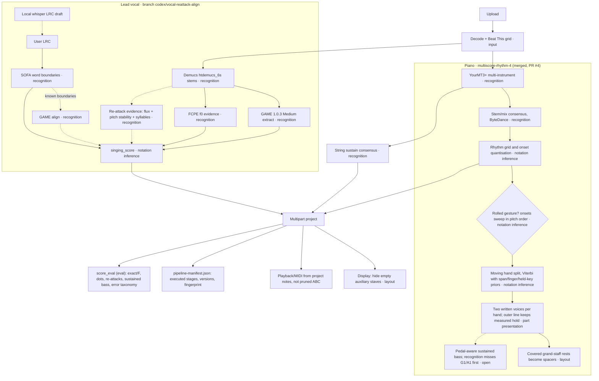

# Coro pipeline (v5)

Status 2026-11-09. Each node names its layer. A change touches one layer at a
time and must keep raw model output, the previous notation and the current
candidate for comparison. Passing tests or a connected model is not musical
acceptance. Bobby's ear and the human reference score are.

Legend: solid = runs in production; dashed = in progress on a branch;
`(eval)` = evaluation only, never feeds inference.

## Production and in-progress branches

## Supporting infrastructure (landed on `codex/coro-v5`)

| Piece | Purpose |
|---|---|
| `server/analysis_lock.py` | Machine-wide lock so parallel checkouts never run heavy models at once |
| `CORO_BACKEND_PORT` / `CORO_FRONTEND_PORT`, `scripts/link-local-assets.sh` | One formal Coro per worktree, own `data/`, shared runtimes |
| `server/pipeline_manifest.py`, `/api/projects/{id}/pipeline` | What actually ran, per stage, with code and component versions |
| `server/score_eval.py` | Evaluation-only comparison with a private human reference, per section, with an error taxonomy |

## Error taxonomy, Kong Er v4 (development song, not blind)

From `score_eval` over reference bars 1–70. Each note is counted once, in this
priority: exact > merged re-attack > onset shift > octave > wrong pitch > missed.

| Part | exact | merged re-attack | onset shift | octave | wrong pitch | missed | extra | split |
|---|---:|---:|---:|---:|---:|---:|---:|---:|
| Lead v3 | 172 | 29 | 101 | 0 | 3 | 7 | 82 | 21 |
| Lead v4 | 239 | 15 | 47 | 0 | 3 | 8 | 46 | 5 |
| Piano | 672 | 1 | 140 | 75 | 71 | 113 | 166 | 12 |
| Strings | 77 | 2 | 75 | 7 | 28 | 23 | 361 | 25 |

What this suggests about which layer to work on:

- **Lead:** remaining errors are mostly onset shifts (notation inference) and
  merged re-attacks (recognition). Pitch is rarely wrong.
- **Piano:** onset shifts and extras/missed notes dominate. Octave and
  wrong-pitch errors are also substantial. That points to recognition
  limits in the mix, not only notation.
- **Strings:** 361 extras against 212 reference notes. The model proposes far
  more string notes than the hand score writes. Some may be real
  doublings the arranger omitted. Do not treat them as errors without
  listening.

## Piano v5 result (Kong Er, development song)

| Bars 1–70 | v4 | v5 |
|---|---:|---:|
| exact / ref (unchanged recognition) | 672/1072 | 672/1072 |
| duration agree | 396 | 450 |
| arpeggio marks | 197 | 93 |
| max voices per staff-bar | 5 | 2 |
| sustained bass covered | 16/33 | 16/33 |

Open trade-off: the inner left-hand voice is written to the next attack. On the Fragile
holdout, reference duration agreement drops 1211 → 1139. Frame agreement with ByteDance
activations (reference-free) is F .615 → .609 and low-register recall .805 → .743.
10 of the 17 uncovered long bass notes are missing or octave-displaced in recognition.

## Vocal v5 status (branch codex/vocal-reattack-align)

Offline candidates (each fixed before scoring, development song only):

| Candidate | Layer | 1–70 exact / F / dotted | Decision |
|---|---|---|---|
| v4 | — | 239 / .73 / 23 | baseline |
| A: replace events with GAME align | recognition | 154 / .39 / 38 | rejected |
| B: align same-pitch splits | recognition | 229 / .64 / 42 | rejected, too many false splits |
| C: B + consonant/onset gate | recognition | 229 / .67 / 30 | rejected |
| D: text-free SOFA edges, self-calibrated | recognition | 239 / .73 / 22 | no gain |
| Step 3: scoop keeps same-pitch re-attack | notation inference | 227 / .68 / 29 | rejected in one pre-registered run |

What ships: GAME align output and text-free syllable edges saved as raw evidence
only (the score is unchanged), plus a fix for SOFA revision checks on release-tarball
installs, which broke uploads that supplied an LRC. Bare Whisper ASR stays an
offline tool: its timestamps are phrase-level drafts, not note boundaries.

## Review discipline

- Any run that reads a reference score is logged, one line per run, in the
  branch's private REVIEW.md, with its purpose.
- A rule is written down before its numbers are seen. It is accepted or
  abandoned in one run per song, with no retuning.
- Fragile's MIDI is Bobby's a cappella arrangement, not a piano or band
  transcription. Use it as a vocal-line holdout only. For piano holdout checks,
  use reference-free invariants and frame agreement with model activations.

## Next candidates (not started)

Ranked by the research report (`evidence/research-20261109/REPORT.md`, private):

- Strings: frame continuity with hysteresis and a cross-window active-note state.
- Score IR + MusicXML, with independent engraving.
- Confidence-driven local review with undo.
- MuScriptor real-mix recognition experiment. Its weights are CC BY-NC, so it
  is research only.
