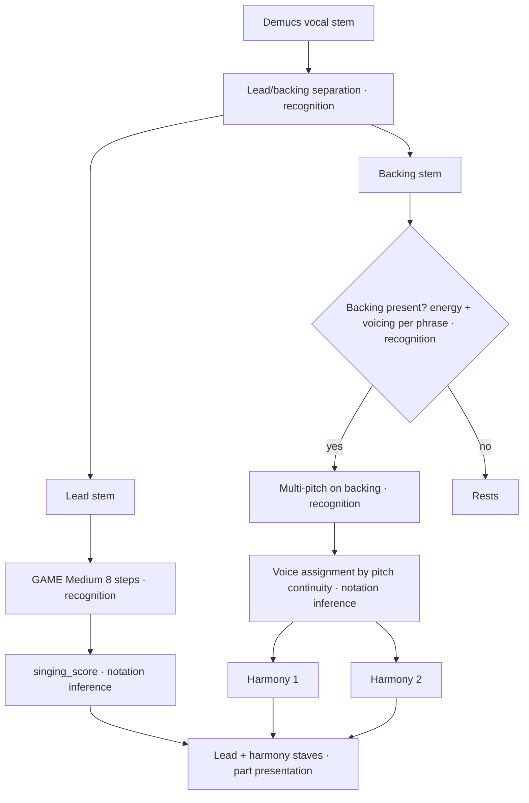
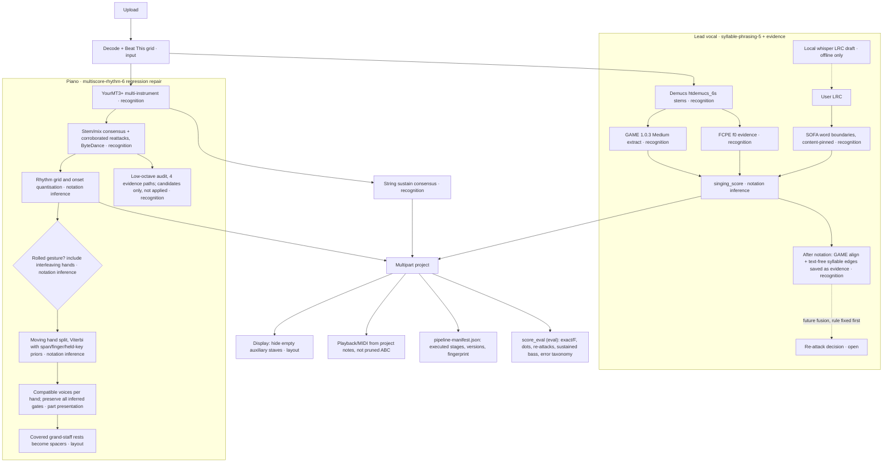

# Coro pipeline (v5)

Status 2026-11-10. Each node names its layer. A change touches one layer at a
time and must keep raw model output, the previous notation and the current
candidate for comparison. Passing tests or a connected model is not musical
acceptance. Bobby's ear and the human reference score are.

Legend: solid = runs in production; dashed = in progress on a branch;
`(eval)` = evaluation only, never feeds inference.

## 2026-11-10 afternoon: piano option B (finger gates + printed pedal)

Bobby chose option B: write what the fingers hold, and show the resonance as
a pedal mark. `multiscore-rhythm-7` changes two layers, one at a time, with
recognition fixed (pitches and attacks are identical to the accepted import).

- Notation inference: `_finger_gates_under_pedal`. When the same hand attacks
  again inside a note's written value while the measured pedal is down
  (pressed by `t + 0.12 s`, not lifted before `t`), the note is written to
  that attack and flagged `pedalSustain`. Kong Er: 337 notes.
- Presentation: `part.pedals` holds printed Ped./* marks. Detector fragments
  closer than 0.4 s merge; a pedal change prints only at a chord change
  within an eighth of a measured release; marks under a quarter beat are not
  printed (86 marks). `part.pedalSustain` holds the measured intervals
  (209) and drives playback resonance only. ABC prints Ped./* below the bass
  staff; MusicXML exports `<pedal>`. The cached-event score rebuild uses the
  same reprint rule as the formal upload.

| Kong Er, reference bars | accepted | option B |
|---|---:|---:|
| exact pitch+onset, 1–70 | 675/1072 | 675/1072 |
| duration agree, 1–70 | 388 | 475 |
| duration agree, 13–24 / 21–35 / 45–54 | 85 / 84 / 65 | 100 / 104 / 70 |
| dotted values | 142 | 137 |
| reference-free frame F (Kong Er / Fragile) | .618 / .615 | .668 / .615 |

A formal upload on the candidate instance reproduced the offline result note
for note, including all printed and measured pedal intervals. The mark
placement and the playback were checked in the rendered score; the musical
judgment of the pedal sound is Bobby's.

## 2026-11-10 research post and rejected vocal rule

The Xiaohongshu post lists RVC, so-vits-svc, UVR, audiocraft, demucs,
DiffSinger, stable-audio-tools, basic-pitch, jukebox and DDSP-SVC. Two were
tested against the accepted baseline:

- Vocal input Mel-Band RoFormer vs Demucs, both into GAME Medium with the
  same notation: 236 vs 239 exact (1–70). Bobby heard no difference between
  the two separations. Not adopted.
- Basic Pitch for piano: onset F .396 vs .584 for the current path. Not
  adopted.

Pre-registered vocal rule `approach-direction-and-energy` for bars 45–54
(allow falling scoops; an energy attack no longer blocks a merge) was run
once and abandoned: 45–54 exact 58 → 57, whole song 239 → 232, same-pitch
re-attacks 67 → 64. Audio rules alone cannot tell a word attack from a
scoop there; lyric/SOFA syllable evidence is needed.

## Next: lead and backing voices (planned)

Bobby heard at least one lead and two harmony voices in bars 55–66. The
whole Demucs vocal stem currently goes to GAME, a monophonic model, so the
harmony is either dropped or leaks into the lead. Planned chain, to be
A/B-tested before it reaches the formal upload:

The hand reference has no harmony voices, so harmony acceptance is by ear.
The lead must not get worse against the reference when it is transcribed
from the separated lead stem instead of the full vocal stem.

## 2026-11-10 piano regression repair

`multiscore-rhythm-6` fixes three notation-layer failures found by holding
decoded events fixed against the previous import. The two-voice keyboard cap
was shortening sustained inner notes in the canonical score, which also drives
playback. Keyboard voice allocation now preserves the inferred note gates and
uses another rhythm layer when necessary. A new bass pitch alone is not release
evidence; absent pedal detection does not rule out a finger hold.

Roll recognition checks plausible interleaving left/right hands, and a new
melody attack cannot truncate another chord tone's measured release. Automatic
beat-unit doubling requires a sustained sequence of short, independently
released attacks; dense held chords no longer count as a fast melodic line.
The original detected grid is retained for repeatable rebuilding.

The private comparison retains the actual 90-second import, a piano-only
ablation, and the combined grid/piano candidate. The full-song piano ablation
keeps every other part unchanged. Model events and user projects are preserved;
no reference notes feed inference. Some inner-note durations still disagree
with the human score, and additional written voices may be necessary. This is
a regression repair, not a claim that piano or vocal transcription is solved.
On 2026-11-10 Bobby accepted the retained comparison as the next development
baseline and requested publication. Remaining differences below stay open.

## 2026-11-10 accepted continuation baseline

`piano-two-view-consensus-2` recovers a held key's missing reattack only when
the stem and mixture piano views agree and native notes support a repeated
chord or regular running voice. These are two views of the same piano model,
not independent models. No previous attack is deleted; the old release is kept
as acoustic evidence. Existing finger-duration inference then sees the complete
run. The source-proposal cache advances to `multiscore-sources-8`.

`syllable-phrasing-5` makes partial-lyric exclusions local, keeps audio-only phase
inference in uncovered phrases, admits ordinary rhythm positions for regularly
repeated same-pitch syllables, and recognizes relatively dominant destinations
in short paired syllable scoops. Genuine word attacks and later melisma remain.
The timing audit now reports the canonical times actually played. No-lyrics
output is unchanged in the fixed-input song comparison.

The frozen GAME Medium / FCPE / piano evidence yields three recovered piano
attacks with none removed; the same-input vocal comparison improves early
repeated syllables. Reference notes are evaluation only. Voice bars 45–54 and
remaining piano inner/bass differences are still open. Keep the accepted
candidate and prior score separately. See `docs/WORK_COMPUTER_HANDOFF.md` for
the user's acceptance scope, private-asset requirements and new research link.

## Production and in-progress branches

## Supporting infrastructure (landed on `codex/coro-v5`)

| Piece | Purpose |
|---|---|
| `server/analysis_lock.py` | Machine-wide lock so parallel checkouts never run heavy models at once |
| `CORO_BACKEND_PORT` / `CORO_FRONTEND_PORT`, `scripts/link-local-assets.sh` | One formal Coro per worktree, own `data/`, shared runtimes |
| `server/pipeline_manifest.py`, `/api/projects/{id}/pipeline` | What actually ran, per stage, with code and component versions |
| `server/score_eval.py` | Evaluation-only comparison with a private human reference, per section, with an error taxonomy |

## Error taxonomy, Kong Er v4 (development song, not blind)

From `score_eval` over reference bars 1–70. Each note is counted once, in this
priority: exact > merged re-attack > onset shift > octave > wrong pitch > missed.

| Part | exact | merged re-attack | onset shift | octave | wrong pitch | missed | extra | split |
|---|---:|---:|---:|---:|---:|---:|---:|---:|
| Lead v3 | 172 | 29 | 101 | 0 | 3 | 7 | 82 | 21 |
| Lead v4 | 239 | 15 | 47 | 0 | 3 | 8 | 46 | 5 |
| Piano | 672 | 1 | 140 | 75 | 71 | 113 | 166 | 12 |
| Strings | 77 | 2 | 75 | 7 | 28 | 23 | 361 | 25 |

What this suggests about which layer to work on:

- **Lead:** remaining errors are mostly onset shifts (notation inference) and
  merged re-attacks (recognition). Pitch is rarely wrong.
- **Piano:** onset shifts and extras/missed notes dominate. Octave and
  wrong-pitch errors are also substantial. That points to recognition
  limits in the mix, not only notation.
- **Strings:** 361 extras against 212 reference notes. The model proposes far
  more string notes than the hand score writes. Some may be real
  doublings the arranger omitted. Do not treat them as errors without
  listening.

## Piano v5 result (Kong Er, development song)

| Bars 1–70 | v4 | v5 |
|---|---:|---:|
| exact / ref (unchanged recognition) | 672/1072 | 672/1072 |
| duration agree | 396 | 450 |
| arpeggio marks | 197 | 93 |
| max voices per staff-bar | 5 | 2 |
| sustained bass covered | 16/33 | 16/33 |

v5.1 (PR #5) adds a pedal-aware inner hold. Kong Er duration agreement is 444,
dotted notes 133, frame F .591. It fires on only 35 notes, because the detected
pedals are short and fragmented. The low-octave audit was right on 2 of 4 promotions,
so it records candidates and does not change the score.

Open trade-off: the inner left-hand voice is written to the next attack. On the Fragile
holdout, reference duration agreement drops 1211 → 1139. Frame agreement with ByteDance
activations (reference-free) is F .615 → .609 and low-register recall .805 → .743.
10 of the 17 uncovered long bass notes are missing or octave-displaced in recognition.

## Vocal v5 status (branch codex/vocal-reattack-align)

Offline candidates (each fixed before scoring, development song only):

| Candidate | Layer | 1–70 exact / F / dotted | Decision |
|---|---|---|---|
| v4 | — | 239 / .73 / 23 | baseline |
| A: replace events with GAME align | recognition | 154 / .39 / 38 | rejected |
| B: align same-pitch splits | recognition | 229 / .64 / 42 | rejected, too many false splits |
| C: B + consonant/onset gate | recognition | 229 / .67 / 30 | rejected |
| D: text-free SOFA edges, self-calibrated | recognition | 239 / .73 / 22 | no gain |
| Step 3: scoop keeps same-pitch re-attack | notation inference | 227 / .68 / 29 | rejected in one pre-registered run |

What ships: GAME align output and text-free syllable edges saved as raw evidence
only (the score is unchanged), plus a fix for SOFA revision checks on release-tarball
installs, which broke uploads that supplied an LRC. Bare Whisper ASR stays an
offline tool: its timestamps are phrase-level drafts, not note boundaries.

## Review discipline

- Any run that reads a reference score is logged, one line per run, in the
  branch's private REVIEW.md, with its purpose.
- A rule is written down before its numbers are seen. It is accepted or
  abandoned in one run per song, with no retuning.
- Fragile's MIDI is Bobby's a cappella arrangement, not a piano or band
  transcription. Use it as a vocal-line holdout only. For piano holdout checks,
  use reference-free invariants and frame agreement with model activations.

## Next candidates (not started)

Ranked by the research report (`evidence/research-20261109/REPORT.md`, private):

- Strings: frame continuity with hysteresis and a cross-window active-note state.
- Score IR + MusicXML, with independent engraving.
- Confidence-driven local review with undo.
- MuScriptor real-mix recognition experiment. Its weights are CC BY-NC, so it
  is research only.
