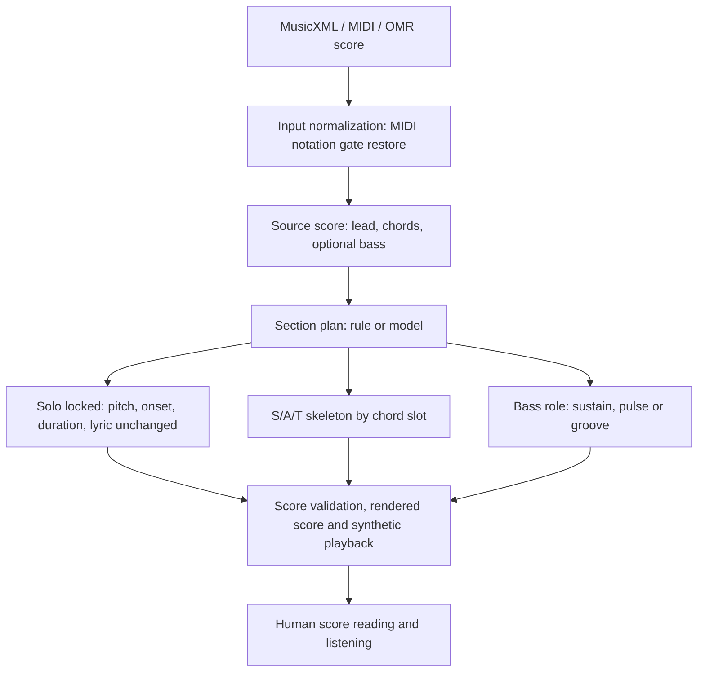
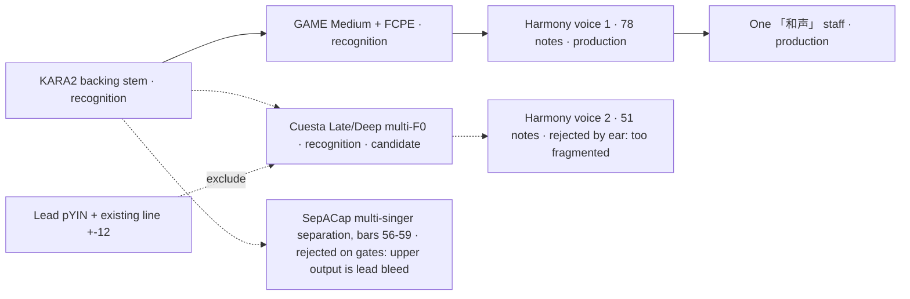
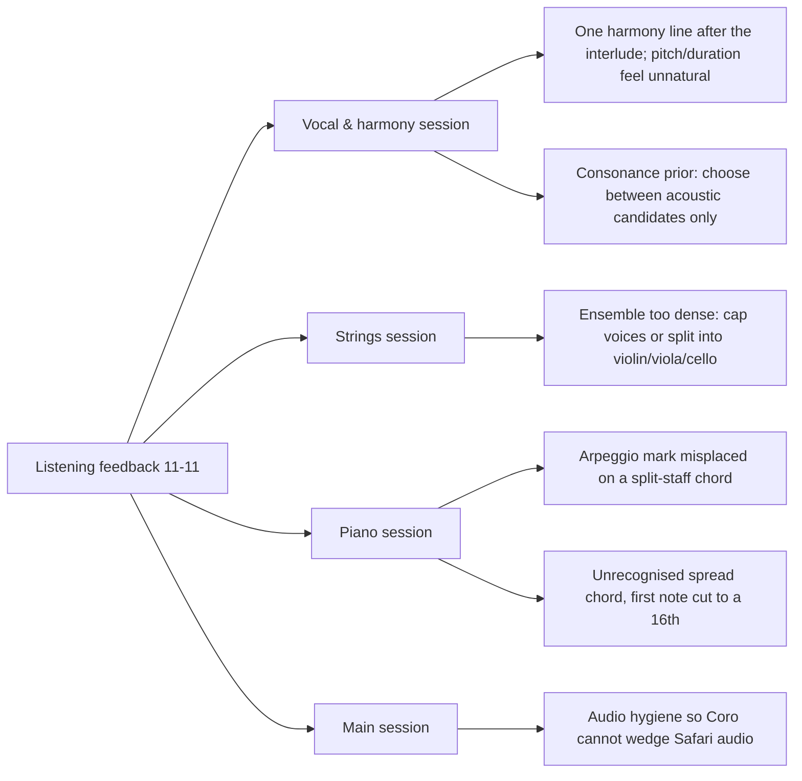
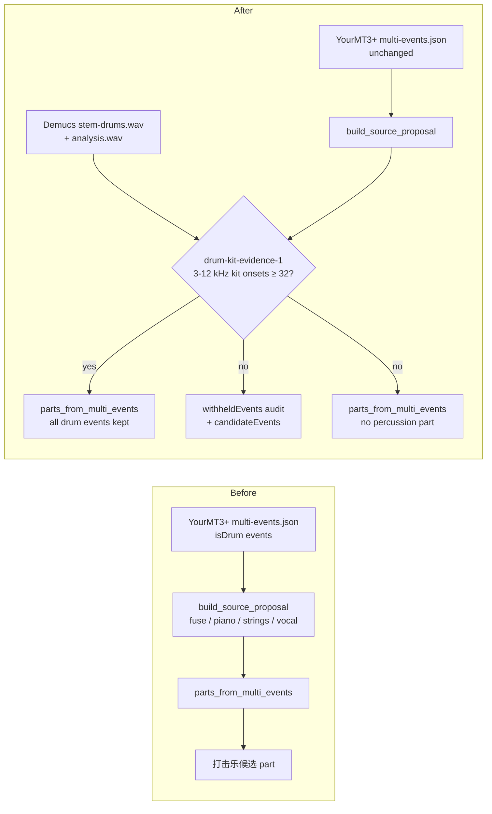
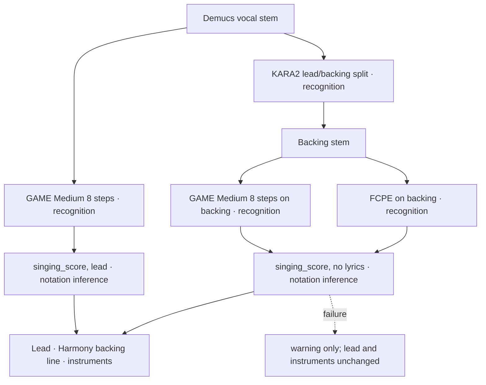
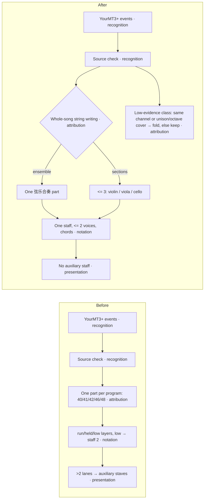
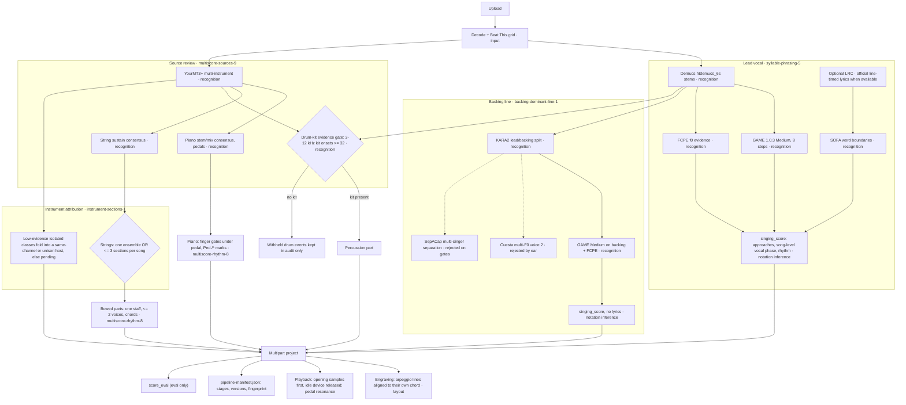

# Coro pipeline (v5)

Status 2026-11-13 (product pivot, see below; audio sections describe the draft-input path). Each node names its layer. A change touches one layer at a
time and must keep raw model output, the previous notation and the current
candidate for comparison. Passing tests or a connected model is not musical
acceptance. Bobby's ear and the human reference score are.

Legend: solid = runs in production; dashed = in progress on a branch;
`(eval)` = evaluation only, never feeds inference.

## 2026-11-14: score input — homr becomes the default OMR engine (recognition layer)

One layer changed: which recognizer reads PDF/images. Raw output of every engine is kept; Audiveris stays installed and selectable.

- **Pre-registered A/B.** Rules were written before any run (private `work/omr-20261114/PROTOCOL.md`).
  - Public pages: the 31 Sheetly OMR benchmark pages (CC BY 4.0) in four conditions: clean render (~242 dpi), half-resolution (~121 dpi), simulated scan (tilt ±1.5°, blur, noise, JPEG), and the benchmark's own simulated phone photo.
  - Metric: the benchmark's strict F1 (pitch, onset in bar and duration all right, page 1). Our run of its scorer on its published Audiveris files reproduces 88.43 / 50.43.
  - Fixed 11-piece TEST split (`crc32(slug) % 3 == 0`), run once; any rule tuning only on the other 20.
- **Result, strict F1 on TEST (all 31 in brackets).**

  | Condition | Audiveris 5.11 (current) | homr 72fdfa8 | copisteria 1.3.4 |
  |---|---:|---:|---:|
  | clean | 79.3 (87.6) | **97.3 (96.7)** | 96.1 (96.0) |
  | half resolution | 74.9 (82.3) | **97.7 (96.9)** | 96.1 (96.1) |
  | simulated scan | 73.4 (83.8) | **97.4 (97.3)** | 95.9 (95.7) |
  | simulated photo | 26.9 (32.5) | **97.2 (96.7)** | 73.7 (71.4) |
  | pieces with no output (all 31) | 1 / 1 / 1 / 16 | 0 | 0 |

- **Same Kong Er ruler as 2026-11-13** (bars 1–70, same pitch on the same sixteenth; all parts, lead in brackets):
  - Audiveris: PDF .880 (.967), half-res .798, scan .723, photo 0 (rejected as "several movements").
  - homr: PDF through Coro's real `recognize()` .901 (.995); half-res .897, scan .901, photo .897 (.955).
  - These are still synthetic degradations of a vector export. Real phone photos, real scans, handwriting and jianpu are not measured.
- **Shipped.** `engine` = `auto` (default: homr, falls back to Audiveris only when homr returns nothing) / `homr` / `audiveris`.
  - homr runs as a separate AGPL process from `models/omr/homr` (`scripts/setup-omr-homr.sh`), pinned commit, SHA256-checked weights, private HOME and blocked proxies.
  - Per-page raw MusicXML is kept in the job folder; pages are merged with homr's own page joiner. Different part counts across pages are reported, not hidden.
  - Old requests without `engine` keep using Audiveris.
- **Rejected / not shipped.**
  - copisteria: weaker on photos and on Kong Er scan/photo; kept as a candidate.
  - Measure-level fusion (take the other engine's bar when homr's bar does not fill its meter): +0.7 clean, −0.6 scan, −2.5 photo on DEV, so it never reached TEST.
  - Cross-engine disagreement as a confidence score: on TEST, bars where homr and Audiveris agree were still wrong 2–10% of the time, so it is not a confidence. Not shown as one.
- **Known gaps of homr.** No lyrics, chord symbols or part names (0 in every output); about 0.7 of the reference's ties; parts named Voice/Piano. Audiveris remains the choice when you want it to try lyrics.
- Test pass and these scores are not musical acceptance. Compare against the source page before rehearsal.

## 2026-11-14: work-computer priority moves to score input and editing

Bobby's listening review: none of the first Solo + SATB drafts is yet a
qualified a cappella arrangement. Arrangement work moves to his personal
computer, where more reference arrangements are available. This computer now
focuses on reliable score input and an efficient correction/editor workflow.

- **Production now:** homr is the default PDF/image engine; Audiveris remains an
  explicit choice and automatic fallback.
- **OMR session:** next layers are text/structure, real-photo and real-scan
  evaluation, then page-region mapping for correction.
- **Editor session:** study Crescendo's interaction model with REA and direct
  use, then independently implement high-value input, selection and correction
  workflows in Coro. Do not copy proprietary code or assets.
- **Arranger:** `solo-satb` remains available for comparison, but it is not
  accepted as a qualified arrangement and is not active work on this computer.

## 2026-11-14: arranger v2 first listening draft

Layers changed one at a time: input normalization, then arrangement.

- **MIDI input.** `fromMidi` now restores written durations only when one export
  gate dominates the file. A free-length control is unchanged. On two local
  Crescendo exports, MusicXML 64th-note elements fall 3392 -> 212 and
  6140 -> 89. Remaining odd values include long pedal/rubato events and are not
  forced onto a grid. `fromMidi(bytes, { restoreNotation: false })` keeps raw values.
- **Solo + SATB.** A new `solo-satb` preset keeps the selected lead as its own
  Solo line. It does not choose an octave, fold notes or shorten tails. Existing
  SATB/SSAA/TTBB presets remain on the v1 engine.
- **Planning.** The same deterministic realizer accepts a rule plan or a model
  plan. On Kong Er, a separate Opus 5.5 High planning session read only bar-level
  structure, not lyrics or the private arrangement.
- **Status.** Tests and engraving passed. A first rendered review found wordless
  lead-following written as repeated "Ooh" on every short attack; it now follows
  phrase anchors. Listening acceptance is still pending.

## 2026-11-13: product pivot — score → a cappella arrangement becomes the core

Decision (Bobby, 2026-11-13): the core path is now a reliable score turned into a
singable a cappella arrangement. Audio-to-full-score becomes a draft input. Full
evidence and the new pipeline diagram are in [PRODUCT_DIRECTION.md](PRODUCT_DIRECTION.md).

- **Evidence.** No published system reaches ~85% for full multi-instrument songs.
  - Vendor self-benchmarks give score-level means of .61–.67: rock band .36, orchestra .22.
  - Independent and academic pop results are lower (MulTTiPop onset F1 about 38).
- **Same song, same reference.** Kong Er bars 1–70, exact pitch on the same sixteenth:

  | Route | Lead | Piano | Strings | All |
  |---|---:|---:|---:|---:|
  | Audio, formal job `73ec215e…` | .749 | .611 | .198 | .548 |
  | Local Audiveris reading the printed PDF of the same hand score | .967 | .870 | .807 | .880 |

  The PDF is a clean vector export, the best case for OMR. Scans, photos and jianpu were not tested.
- **The arranger, not the input, is the bottleneck.** Given the 100%-correct hand
  score, the current `arrangeForVoices` output is mechanical:
  - It moves the lead an octave up into Soprano.
  - A/T/B repeat one rhythm in all 70 bars, with only oo/dm.
  - VP is a fixed pattern throughout.
  - Its own report flags only octave folds, inferred chords and three large leaps; nothing flags the uniform texture.
- **Input bug found.** Some notation-software MIDI exports gate notes at about 95%
  (0.475 beat for 0.5). `fromMidi` keeps that, so MusicXML export shows 64th-note
  fragments and quintuplets. MusicXML input does not have the problem.
- **Maintenance mode.** Note-level piano inner voices, strings and drums from audio
  get bug fixes only. Lead and harmony recognition stays with the vocal & harmony
  session, because it feeds the arranger.
- **Arranger v2 research.** Running in a With (Claude Fable 5.2 High) session.
  - Brief and plan are private: `work/research-20261114-arranger/`.
  - No arranger code changes until Bobby approves the plan.

## 2026-11-12: official LRC baseline; backing second layer and multi-singer separation rejected

- **LRC input (production, no code change).** The 《空耳》 lyric input is the
  official NetEase line-timed LRC. The text matches two other sources. Line times
  move to a clean lead-stem onset only within 0.7 s.
  Formal upload `73ec215e…` on main `23a5bcd` reproduces the offline baseline
  note for note. Lead 1-70 exact 239 -> 245, re-attacks 67 -> 76, S2 8 -> 7,
  extra 46 -> 39, but bars 55-70 41 -> 39. Every other part is identical.
  This upload is now the baseline for A/B.
- **Rejected (vocal session, one run each).**
  - `syllable-scoop-grace-1`: 245 -> 249, but bars 13-24 -2 and re-attacks -2.
  - `word-onset-written-1`: S2 7 -> 6, below the <= 4 gate.
- **Backing second layer `cuesta-second-voice-1`** (recognition layer, candidate, not merged):
  - **What it does.** Cuesta Late/Deep multi-F0 (MIT) runs on the same KARA2 backing stem. It adds a voice 2 to the single 「和声」 staff. It excludes the lead pitch, the existing line, and that line's octave.
  - **Gates.** All seven pre-registered gates passed on one run:
    - 46/51 added notes are supported by pYIN or Basic Pitch.
    - 2/51 are unison with the lead.
    - Control sections get 0 added notes.
    - The 78 existing notes and every other part are identical.
  - **Coverage.** The line now covers more of the backing time that is voiced at a pitch distinct from the lead, in bars 47-64: 46 % -> 54 %.
  - **Judgement.** The added layer is pointillistic: 45/51 are sixteenths. Bars 56-59 gain 7 notes.
  - **Bobby's listening (11-12): rejected, too fragmented.** The formal lead + one-line harmony sounds better. Production keeps the 78-note line unchanged.
- **SepACap multi-singer separation, bars 56-59** (recognition layer, vocal & harmony session): **abandoned on pre-registered gates**, one run, no retuning.
  - **Input.** The KARA2 backing stem. Controls: bars 13-16 (no backing) and 47-50 (single harmony).
  - **Low layer separates.** The bass and tenor outputs follow the formal octave-below line on about 70 % of voiced frames.
  - **Upper (female) layer does not.** The selected upper output fails three gates:
    - 23 % of its frames are unison with the lead (gate <= 20 %).
    - It is only 12 dB quieter in the no-backing control (gate >= 20 dB).
    - Only 21 % of it lands on the single harmony line in bars 47-50 (gate >= 50 %).
  - **Through GAME.** 13 notes; 9 are a sixteenth or shorter; mean 0.31 beat. Only 3/13 are supported; 4/13 are unison with the lead. This is no more continuous than Cuesta.
  - **Likely cause (not verified).** A domain gap: clean jaCappella multitracks versus a -30 dB KARA2 residual with lead bleed. UNMIXX was not run.
  - **Production.** It keeps the one-line, 78-note harmony, which Bobby preferred by ear.

## 2026-11-11 evening: listening feedback round 2

Bobby listened in Chrome (Safari's media process was wedged, see below).
Section quality against the hand score, formal job `24b80117…`, evaluation only:

| Part | 5–20 | 21–35 | 36–43 (interlude) | 44–54 | 55–66 |
|---|---:|---:|---:|---:|---:|
| Lead F | .71 | .78 | – | .71 | .77 |
| Piano F | .72 | .61 | .69 | .53 | .53 |
| Strings F | – | .21 | .24 | .27 | .13 |

After the interlude the piano loses accuracy (missed, extra and octave notes all rise), and the strings
part writes 2.5–4× the hand score's notes. The hand score's strings after the interlude are
incomplete, so bars 44–66 are only indicative for strings.

Work routed to the existing dedicated sessions (Bobby's preference: no new session per issue):

Outcome of the three dedicated sessions. Each rule was written before its numbers were seen and run once on Kong Er:

| Session | Change | Layer | Result | Decision |
|---|---|---|---|---|
| Piano | Arpeggio line drawn on its own chord in beamed, up-stem groups (`alignEngravingArpeggios`, app/PDF/video) | layout | detached lines 2 → 0; arpeggio count 51 → 51; notes unchanged | merged (PR #15) |
| Piano | Regroup the bar-10 spread chord | notation inference | still fails "80% long" (A4/C#4 releases recognised short); removed correct rolls at bars 65–66 | rejected |
| Piano | Lengthen A4/C#4 releases from both ByteDance views | recognition | premise not met: no A4 attack in the stem view; views disagree on C#4 | not implemented |
| Vocal & harmony | Consonance tie-break between acoustic pitch candidates | recognition (pitch choice) | agreement with an independent pYIN contour 52 → 47 of 76 | rejected |
| Vocal & harmony | Use FCPE pitch when it is stable and disagrees with GAME | recognition (pitch choice) | 6 notes changed, 3 match pYIN (gate 60%) | rejected |
| Strings | Source-evidence gate for string notes | recognition | bars 21–43 exact 37 → 24 | rejected |
| Strings | Three single lines (violin/viola/cello) by register | notation inference | lower F in 21–43; lost real violin notes in a synthetic check | rejected |

What was learned:

- **Piano after the interlude:** wrong-pitch and octave errors grow once the strings enter. Octave errors go from 18 to 38–40 per section. They are not leaks from the vocal or string reference lines; YourMT3+ recognition is limited in a denser mix.
- **Harmony:** the formal score has one line. Only about two thirds of its notes agree with the pitch the backing stem sings. About half of the second voice after bar 47 is not transcribed, and bars 56–59 come out as parallel octaves. A consonance prior made the line look more consonant on paper but moved it away from the sung pitch, so it is not a pitch estimator.
- **Strings:** in Kong Er the strings often double the piano or the voice in unison. Stem-energy rules therefore cannot tell a leak from a real doubling: 11 of the 37 matched notes are piano- or vocal-dominant in the stems.
- **Next step:** all three remaining problems need better recognition, for example a multi-voice singing model on the backing stem, or syllable evidence from a corrected LRC. More rules in the notation layers will not fix them.

Consonance prior (Bobby's idea): 50 of 78 backing-line notes are outside the piano's sounding
pitch classes; 44 of 78 are non-chord tones of Coro's own chord symbols, against 143/340 for the lead.
The prior may only decide between candidates that already have acoustic support (GAME pitch vs
FCPE contour, octave or neighbouring semitone). It never invents or deletes notes, and must not
use chord symbols inferred from the same uncertain notes. It was tested once and rejected (see the table above).

Safari: after an AirPods route change, `com.apple.WebKit.GPU` (running for 26 days) failed to
acquire the CoreAudio assertion (RBS error 4099) and `_StartIO` failed until Safari was quit.
Coro now keeps one media element per context, warms samples in an OfflineAudioContext, and
suspends the audio device after 20 s idle or when hidden (PR #14).

## 2026-11-11 vocal attempts rejected (no code shipped)

Both were written down before their numbers were seen and run once on Kong Er.

| Attempt | Layer | Kong Er result | Decision |
|---|---|---|---|
| `scoop-grace-1`: an unworded short lower note glued to a stable target 1–3 st higher becomes a grace note before the target | notation inference | exact 239 → 243; reattacks 67 → 64; bars 13–24 and 45–54 each −1 | rejected |
| Phase tolerance band: accept the whole span from the raw onset back to the raw onset minus 0.06 s, instead of shifting by 0.06 s | notation inference | exact 239 → 236; S2 still 8 | rejected |

Without lyrics, a sung scoop and two syllables on adjacent pitches look the same,
and the onsets helped or hurt by the song-level vocal phase overlap. Both need
syllable evidence (LRC + SOFA). Diffs are kept privately in `work/vocal-scoop-20261111/`
and `work/vocal-phase-20261111/`.

## 2026-11-11: drum-kit evidence gate (`drum-kit-evidence-1`, recognition layer)

Kong Er has no percussion, yet YourMT3+ emitted 25 GM drum events (program 128)
that reached the score as a 打击乐候选 part. Diagnosis on the formal upload, with
measurements only and no listening by the assistant:

- Seven instants (bars ~26, 29.75, 41, 54.9, 61, 63) carry a real burst in the
  Demucs drum stem: a ~43-58 Hz decaying sine, sliding downward, about 6 dB above
  the song's mixture RMS, with no energy above 2 kHz and the bass/piano low notes
  sounding together. These are low impacts (sub-bass thumps on bar downbeats),
  heard by YourMT3+ as kick plus toms. They have no snare, hi-hat or cymbal transient.
- The other ten instants have no drum-stem energy (-44 to -60 dB). They fall on
  piano chord attacks, short string articulations and vocal sibilance/breaths. The
  closed hi-hats at bars 60.6-60.9 and 62.75 match >5 kHz rises only in the vocal stem.

YourMT3+ and Demucs agree on the low thumps, so a per-event energy check
would keep exactly the wrong events. The gate instead judges the whole song: a
drum kit produces steep 3-12 kHz onsets that the drum source owns. Rule
registered before any measurement: count drum-stem onsets rising ≥12 dB within
100 ms and no more than 10 dB below the mixture in that band. With ≥32 onsets every native
drum event is kept; otherwise all are withheld from the default score. They
remain in `candidateEvents` and in `sourceRefinement.drumKit.withheldEvents`.
`multi-events.json` is never rewritten. Without a drum stem the gate keeps the events.

One run per song, no retuning. Kong Er: 0 kit onsets, 25/25 withheld, every
other part's note count is unchanged. Out of Time: 741 kit onsets, 786/786
drums kept. Hurt (NewJeans): YourMT3+ emitted no drum events, so the
gate had nothing to decide; it is not evidence about preserving real drums. The source
cache advances to `multiscore-sources-9`.

## 2026-11-10 afternoon: piano option B (finger gates + printed pedal)

Bobby chose option B: write what the fingers hold, and show the resonance as
a pedal mark. `multiscore-rhythm-7` changes two layers, one at a time, with
recognition fixed (pitches and attacks are identical to the accepted import).

- Notation inference: `_finger_gates_under_pedal`. When the same hand attacks
  again inside a note's written value while the measured pedal is down
  (pressed by `t + 0.12 s`, not lifted before `t`), the note is written to
  that attack and flagged `pedalSustain`. Kong Er: 337 notes.
- Presentation: `part.pedals` holds printed Ped./* marks. Detector fragments
  closer than 0.4 s merge; a pedal change prints only at a chord change
  within an eighth of a measured release; marks under a quarter beat are not
  printed (86 marks). `part.pedalSustain` holds the measured intervals
  (209) and drives playback resonance only. ABC prints Ped./* below the bass
  staff; MusicXML exports `<pedal>`. The cached-event score rebuild uses the
  same reprint rule as the formal upload.

| Kong Er, reference bars | accepted | option B |
|---|---:|---:|
| exact pitch+onset, 1–70 | 675/1072 | 675/1072 |
| duration agree, 1–70 | 388 | 475 |
| duration agree, 13–24 / 21–35 / 45–54 | 85 / 84 / 65 | 100 / 104 / 70 |
| dotted values | 142 | 137 |
| reference-free frame F (Kong Er / Fragile) | .618 / .615 | .668 / .615 |

A formal upload on the candidate instance reproduced the offline result note
for note, including all printed and measured pedal intervals. The mark
placement and the playback were checked in the rendered score; the musical
judgment of the pedal sound is Bobby's.

## 2026-11-10 research post and rejected vocal rule

The Xiaohongshu post lists RVC, so-vits-svc, UVR, audiocraft, demucs,
DiffSinger, stable-audio-tools, basic-pitch, jukebox and DDSP-SVC. Two were
tested against the accepted baseline:

- Vocal input Mel-Band RoFormer vs Demucs, both into GAME Medium with the
  same notation: 236 vs 239 exact (1–70). Bobby heard no difference between
  the two separations. Not adopted.
- Basic Pitch for piano: onset F .396 vs .584 for the current path. Not
  adopted.

Pre-registered vocal rule `approach-direction-and-energy` for bars 45–54
(allow falling scoops; an energy attack no longer blocks a merge) was run
once and abandoned: 45–54 exact 58 → 57, whole song 239 → 232, same-pitch
re-attacks 67 → 64. Audio rules alone cannot tell a word attack from a
scoop there; lyric/SOFA syllable evidence is needed.

## 2026-11-10 evening: backing-vocal line (`backing-dominant-line-1`)

Bobby heard at least one lead and two harmony voices in bars 55–66. GAME is a
monophonic model, so the full vocal stem gives one line. Each step below was
written down before its numbers were seen and run once.

| Step | Layer | Result | Decision |
|---|---|---|---|
| Lead from the KARA2 lead stem instead of the full stem | recognition input | 1–70 exact 239 → 238; 45–54 58 → 54 | rejected; lead stays on the full stem |
| Lead/backing separator: KARA2 vs becruily Mel karaoke (same Demucs stem) | recognition | Bobby's blind listen preferred KARA2 overall; becruily's backing carried more lead-pitch notes | KARA2 |
| Backing → YourMT3+ → joint two-voice assignment | recognition + notation | YourMT3+ decoded the backing as one voice (92 notes, no overlaps): A 83, B 0 | rejected |
| Backing → Basic Pitch → same assignment | recognition + notation | A 198, B 27; 40% of notes ≤ 1/32, rendered score unreadable | rejected |
| Backing → GAME Medium 8 steps → shared singing notation | recognition + notation | 78 notes, 3.8% ≤ 1/32 (lead 6.2%), no notes in the no-backing control bars, 0 lead duplicates in 55–66 | adopted |

What ships in the formal multi upload, after the GAME lead is final:

The part is named “和声 · 伴唱主导线” and plays the backing stem as its
reference audio. It is one line: when two backing voices sing at once it
follows the dominant one. The second harmony is not recovered and is not
invented. Recovering it needs a recognizer that is polyphonic for voices;
the two multi-pitch models tried here fail in recognition, not assignment.
The hand reference has no harmony voices, so the harmony is accepted by ear.

## 2026-11-10 piano regression repair

`multiscore-rhythm-6` fixes three notation-layer failures found by holding
decoded events fixed against the previous import. The two-voice keyboard cap
was shortening sustained inner notes in the canonical score, which also drives
playback. Keyboard voice allocation now preserves the inferred note gates and
uses another rhythm layer when necessary. A new bass pitch alone is not release
evidence; absent pedal detection does not rule out a finger hold.

Roll recognition checks plausible interleaving left/right hands, and a new
melody attack cannot truncate another chord tone's measured release. Automatic
beat-unit doubling requires a sustained sequence of short, independently
released attacks; dense held chords no longer count as a fast melodic line.
The original detected grid is retained for repeatable rebuilding.

The private comparison retains the actual 90-second import, a piano-only
ablation, and the combined grid/piano candidate. The full-song piano ablation
keeps every other part unchanged. Model events and user projects are preserved;
no reference notes feed inference. Some inner-note durations still disagree
with the human score, and additional written voices may be necessary. This is
a regression repair, not a claim that piano or vocal transcription is solved.
On 2026-11-10 Bobby accepted the retained comparison as the next development
baseline and requested publication. Remaining differences below stay open.

## 2026-11-10 accepted continuation baseline

`piano-two-view-consensus-2` recovers a held key's missing reattack only when
the stem and mixture piano views agree and native notes support a repeated
chord or regular running voice. These are two views of the same piano model,
not independent models. No previous attack is deleted; the old release is kept
as acoustic evidence. Existing finger-duration inference then sees the complete
run. The source-proposal cache advances to `multiscore-sources-8`.

`syllable-phrasing-5` makes partial-lyric exclusions local, keeps audio-only phase
inference in uncovered phrases, admits ordinary rhythm positions for regularly
repeated same-pitch syllables, and recognizes relatively dominant destinations
in short paired syllable scoops. Genuine word attacks and later melisma remain.
The timing audit now reports the canonical times actually played. No-lyrics
output is unchanged in the fixed-input song comparison.

The frozen GAME Medium / FCPE / piano evidence yields three recovered piano
attacks with none removed; the same-input vocal comparison improves early
repeated syllables. Reference notes are evaluation only. Voice bars 45–54 and
remaining piano inner/bass differences are still open. Keep the accepted
candidate and prior score separately. See `docs/WORK_COMPUTER_HANDOFF.md` for
the user's acceptance scope, private-asset requirements and new research link.

## 2026-11-11 string sections and instrument attribution (`instrument-sections-1`, `multiscore-rhythm-8`)

Feedback: the Kong Er strings were split too finely (violin, viola, cello and
ensemble all at once, each on 2–5 staves), and a harp appeared that is not in
the original backing.

Where the splitting came from:

| Layer | Before | After |
|---|---|---|
| Recognition (YourMT3+ mc13) | All string classes share decoder channel 5; one bowed texture is labelled 40/41/42/48 at the same instants. Harp (46) is 4 notes on the same channel | Unchanged; `multi-events.json` and `multi-source-events.json` are never rewritten |
| Source check | Exact same-time duplicate labels merged to 48 (30 events) | Unchanged |
| Attribution (new, readable score only) | One part per decoded program | One written form per song: either one string ensemble or at most violin/viola/cello. Sections only if solo classes are >= 50% of bowed notes and violin > viola > cello by median pitch. Classes with < max(12, 1%) notes fold into the same-decoder-channel part or a part covering >= 75% of them at unison/octave; otherwise unchanged. Every relabel is in `scoreConversion.instrumentSections` |
| Notation (`score_rhythm`) | Bowed parts used the generic run/held/low layers; `low` layer went to staff 2 | Bowed parts: one staff, voice 1 moving line with chords/double stops, voice 2 a long note across later attacks; same-attack same-pitch duplicates merged |
| Presentation (`engraving.ts`) | > 2 lanes per staff added auxiliary staves ("· 3", "· 4") | Unchanged code; a bowed part now arrives with one declared staff and <= 2 voices, so no auxiliary staff is created |

Kong Er (cached events, development song, not blind; reference used only for acceptance):

| bars 1–70, strings | current | attribution only | attribution + notation |
|---|---:|---:|---:|
| string parts / staves | 5 parts / 13 staves (+ harp) | 1 / 3 | 1 / 1 |
| notes | 573 | 572 (1 harp unison absorbed) | 556 (16 same-attack duplicates) |
| exact / 212 ref | 77 | 76 | 76 |
| F | .196 | .194 | .198 |
| duration agree | 46 | 46 | 45 |

Regression on cached events (recognition unchanged): Fragile keeps all
high-evidence parts (2 clean-guitar notes fold into acoustic guitar, same
channel); a synthetic flute/violin/cello excerpt keeps violin and cello as two
parts and the flute unchanged; Sugar Plum Fairy (ensemble-dominated) becomes one
string ensemble and its bassoon/clarinet stay separate. Low-evidence guitar,
bass, synth lead and synth pad in Kong Er have no same-channel host and no
unison cover; they are kept unchanged and listed as pending in the audit.

## Production pipeline (main, 2026-11-12)

## Supporting infrastructure (landed on `codex/coro-v5`)

| Piece | Purpose |
|---|---|
| `server/analysis_lock.py` | Machine-wide lock so parallel checkouts never run heavy models at once |
| `CORO_BACKEND_PORT` / `CORO_FRONTEND_PORT`, `scripts/link-local-assets.sh` | One formal Coro per worktree, own `data/`, shared runtimes |
| `server/pipeline_manifest.py`, `/api/projects/{id}/pipeline` | What actually ran, per stage, with code and component versions |
| `server/score_eval.py` | Evaluation-only comparison with a private human reference, per section, with an error taxonomy |

## Error taxonomy, Kong Er v4 (development song, not blind)

From `score_eval` over reference bars 1–70. Each note is counted once, in this
priority: exact > merged re-attack > onset shift > octave > wrong pitch > missed.

| Part | exact | merged re-attack | onset shift | octave | wrong pitch | missed | extra | split |
|---|---:|---:|---:|---:|---:|---:|---:|---:|
| Lead v3 | 172 | 29 | 101 | 0 | 3 | 7 | 82 | 21 |
| Lead v4 | 239 | 15 | 47 | 0 | 3 | 8 | 46 | 5 |
| Piano | 672 | 1 | 140 | 75 | 71 | 113 | 166 | 12 |
| Strings | 77 | 2 | 75 | 7 | 28 | 23 | 361 | 25 |

What this suggests about which layer to work on:

- **Lead:** remaining errors are mostly onset shifts (notation inference) and
  merged re-attacks (recognition). Pitch is rarely wrong.
- **Piano:** onset shifts and extras/missed notes dominate. Octave and
  wrong-pitch errors are also substantial. That points to recognition
  limits in the mix, not only notation.
- **Strings:** 361 extras against 212 reference notes. The model proposes far
  more string notes than the hand score writes. Some may be real
  doublings the arranger omitted. Do not treat them as errors without
  listening.

## Piano v5 result (Kong Er, development song)

| Bars 1–70 | v4 | v5 |
|---|---:|---:|
| exact / ref (unchanged recognition) | 672/1072 | 672/1072 |
| duration agree | 396 | 450 |
| arpeggio marks | 197 | 93 |
| max voices per staff-bar | 5 | 2 |
| sustained bass covered | 16/33 | 16/33 |

v5.1 (PR #5) adds a pedal-aware inner hold. Kong Er duration agreement is 444,
dotted notes 133, frame F .591. It fires on only 35 notes, because the detected
pedals are short and fragmented. The low-octave audit was right on 2 of 4 promotions,
so it records candidates and does not change the score.

Open trade-off: the inner left-hand voice is written to the next attack. On the Fragile
holdout, reference duration agreement drops 1211 → 1139. Frame agreement with ByteDance
activations (reference-free) is F .615 → .609 and low-register recall .805 → .743.
10 of the 17 uncovered long bass notes are missing or octave-displaced in recognition.

## Vocal v5 status (branch codex/vocal-reattack-align)

Offline candidates (each fixed before scoring, development song only):

| Candidate | Layer | 1–70 exact / F / dotted | Decision |
|---|---|---|---|
| v4 | — | 239 / .73 / 23 | baseline |
| A: replace events with GAME align | recognition | 154 / .39 / 38 | rejected |
| B: align same-pitch splits | recognition | 229 / .64 / 42 | rejected, too many false splits |
| C: B + consonant/onset gate | recognition | 229 / .67 / 30 | rejected |
| D: text-free SOFA edges, self-calibrated | recognition | 239 / .73 / 22 | no gain |
| Step 3: scoop keeps same-pitch re-attack | notation inference | 227 / .68 / 29 | rejected in one pre-registered run |

What ships: GAME align output and text-free syllable edges saved as raw evidence
only (the score is unchanged), plus a fix for SOFA revision checks on release-tarball
installs, which broke uploads that supplied an LRC. Bare Whisper ASR stays an
offline tool: its timestamps are phrase-level drafts, not note boundaries.

## Review discipline

- Any run that reads a reference score is logged, one line per run, in the
  branch's private REVIEW.md, with its purpose.
- A rule is written down before its numbers are seen. It is accepted or
  abandoned in one run per song, with no retuning.
- Fragile's MIDI is Bobby's a cappella arrangement, not a piano or band
  transcription. Use it as a vocal-line holdout only. For piano holdout checks,
  use reference-free invariants and frame agreement with model activations.

## Next candidates (not started)

Ranked by the research report (`evidence/research-20261109/REPORT.md`, private):

- Strings: frame continuity with hysteresis and a cross-window active-note state.
- Score IR + MusicXML, with independent engraving.
- Confidence-driven local review with undo.
- MuScriptor real-mix recognition experiment. Its weights are CC BY-NC, so it
  is research only.
