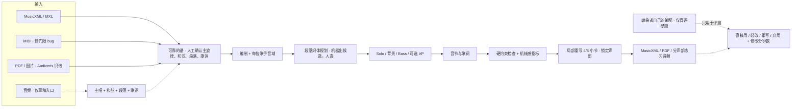

# 产品方向：从“音频转总谱”转向“谱 → 阿卡贝拉改编”

决定日期：2026-11-13（Bobby 确认）。私人调研报告在本机 `work/research-20261113/`，不入库。

## 为什么转向

**外部证据**：这几次检索里，没有任何系统能把多乐器整首流行歌转成完整总谱并达到约 85%。

| 来源 | 证据级别 | 关键数字 |
|---|---|---|
| Klangio Music Transcription Benchmark 2026（厂商自测，有利益冲突） | 全文已读 | 130 段 1 分钟片段，score F1 均值 .67。各类：指弹吉他 .94、清唱 .73、流行钢琴 .63、摇滚乐队 .36、管弦乐 .22 |
| Songscription SOTA 博客（厂商自测，有利益冲突） | 全文已读 | 多乐器→谱 61.1（MUSTER 与 OMR-NED 平均）；人声只出一行，合唱不分声部 |
| MusicRadar 评测（独立，2025-12） | 全文已读 | 音高准，节奏和拍号常错；全乐队歌节奏混乱 |
| MulTTiPop（arXiv 2607.08756） | 表格已读 | 572 个真实流行片段，onset F1 最好约 38 |
| 2025 AMT Challenge（arXiv 2603.27528） | 表格已读 | 限定条件下冠军 F1 .60；从单乐器到三乐器，冠军 .72 → .44 |

**同曲对照**：《空耳》，以手扒谱为参照，1–70 小节；音高相同且落在同一个十六分位置才算对。

| 路线 | 主唱 | 钢琴 | 弦乐 | 全部 |
|---|---:|---:|---:|---:|
| 音频正式流程（GAME + 官方 LRC） | .749 | .611 | .198 | .548 |
| 本地 Audiveris 读回同一份 PDF | .967 | .870 | .807 | .880 |

这份 PDF 是记谱软件直接导出的矢量谱，是识谱的最好情况。扫描件、照片、手写谱和简谱没有测。手扒谱的弦乐在间奏后不完整，所以只比主唱最公平。

**现有编配器的问题**：即使输入是完全正确的手扒谱，现有编配器的结果也很机械。

- 主唱被放进 Soprano，整体升一个八度。
- A/T/B 全曲每小节都是同一种节奏，音节只有 oo/dm。
- VP 从头到尾都是同一拍型。
- 自检只报出八度折叠、和弦是推测的、3 次较大跳进，看不出全曲织体一成不变。

所以瓶颈在编配器，不在输入。

## 新的定位

- **主入口：可靠的谱。**
  - MusicXML/MXL
  - MIDI（先修门限 bug，见下文）
  - PDF/图片识谱（Audiveris）
  - 从记谱软件导出的文件
- **音频降为草稿入口**，只产出编配需要的四样东西：主唱旋律、和弦、段落和速度、歌词（官方 LRC）。
  - 结果必须经人工校对，不对外承诺逐乐器精确转谱。
  - 钢琴内声部、弦乐、打击乐的逐音转谱进入维护模式：保留现有能力并修 bug，不再作为主线优化。
  - 主唱与和声的识别仍由「主唱 & 和声」专门 session 维护，因为它直接给编配提供旋律。
- **核心工作：编配器 v2。** 方案调研进行中，见下节；在 Bobby 拍板前不改编配代码。

## 已知的第一批问题（尚未修复）

- **MIDI 导入门限**：某些记谱软件导出的 MIDI，音符时值只占约 95%（0.475 拍代替 0.5 拍）。`fromMidi` 原样保留，导出 MusicXML 时出现大量六十四分碎片和五连音。MusicXML 路线没有这个问题。
- **主唱八度**：编配器把主唱放进 Soprano，并按音域中心整体移八度。流行阿卡贝拉通常有独立的 Solo 谱表，主唱应保持原调原音区。
- **织体一成不变**：没有段落规划；背景声部和 bass 只用同一种节奏；VP 是固定模板。
- **自检看不出机械感**：现有检查只覆盖音域、换气、跳进、交叉。

## 编配器 v2 的调研进度

- 2026-11-13：调研交给 With 应用里的 Claude Fable 5.2（High）独立会话，项目名「Coro 合声」。AI Hub 调用 Fable 5.2 出过错，所以没用子 agent。
  - 简报：`work/research-20261114-arranger/BRIEF.md`（私有）。
  - 交付：`work/research-20261114-arranger/PLAN.md`（私有）。
  - 主 session 核对后再给 Bobby。
- 要回答的问题：
  - 专业流行阿卡贝拉的编曲工作法；
  - 各算法路线：规则加约束优化、织体模板、符号生成模型、LLM 规划加确定性实现，及其许可和本地运行性；
  - 和声层、音节与歌词层、可用数据、竞品；
  - 机械感与可唱性怎样自动评测；
  - 里程碑：建议先做 M0（修输入，Solo 保持原音区），再做段落织体、bass 与背景节奏、音节、局部重写。

## 评测原则

- 编曲者自己的编配只作盲评参照，不作推理输入、检索模板或调参目标。
- 主要指标是“直接用 / 轻改 / 重写 / 弃用”四档，加上交付前修改所花的分钟数，不用逐音一致率。
- 硬约束检查通过，或机械感指标好看，都不等于好听、可唱；最终以听唱和真人排练为准。
