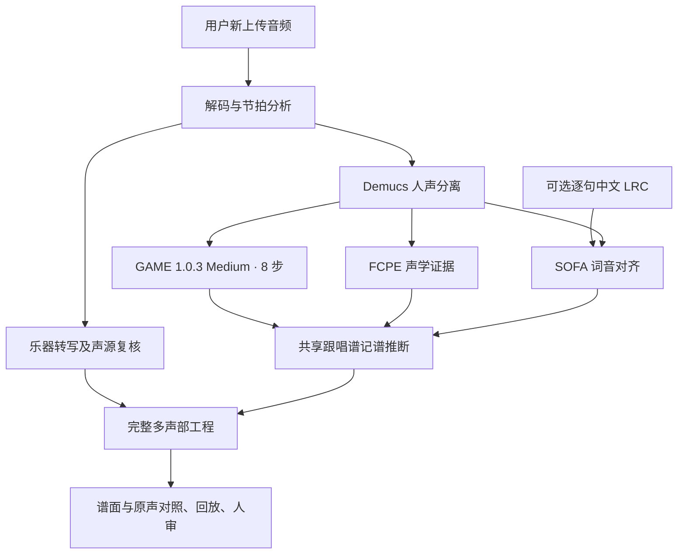

# 工作电脑交接 · 2026-11-13

## 2026-11-13 更新（产品转向：谱 → 阿卡贝拉）

- **方向调整（Bobby 确认）**：核心改为“可靠的谱 → 可排练的阿卡贝拉改编”。音频 → 总谱降为草稿入口。
  依据和新流程图见 `docs/PRODUCT_DIRECTION.md`。
  私有完整报告在 `work/research-20261113/REPORT.md`；编配调研在同目录的 `arrangement.md`。
- **同曲对照**：《空耳》1–70 小节，以手扒谱为参照，同一把尺子。
  - 音频正式流程：全部声部 F .548，主唱 .749。
  - 本地 Audiveris 读回同一份 PDF：全部 .88，主唱 .967。
  - 识谱分三批跑，任务 `02168ff4…`、`4cb5985d…`、`424dc9d2…`，共约 103 秒。
  - 评测脚本 `work/research-20261113/eval/omr_full_eval.py` 仅用于验收。
- **现有编配器的基线**：
  - 输入是手扒谱 MIDI。
  - 产物在 `work/research-20261113/arrange-baseline/`，可以用 Crescendo 打开。
  - 问题：主唱被整体升八度放进 Soprano；A/T/B 全曲同一节奏；VP 固定模板；自检看不出机械感。
- **新发现的 bug，未修**：记谱软件导出的 MIDI 门限约 95%，`fromMidi` 原样保留，导出时出现六十四分碎片。
- **维护模式**：钢琴、弦乐、打击乐的逐音转谱只修 bug。「主唱 & 和声」session 继续维护主唱和和声识别。
  钢琴、弦乐、打击乐 session 暂不派新任务。
- **编配器 v2 调研**：AI Hub 调用 Fable 5.2 的子 agent 因负载报错中止。
  已改为在 With 应用开独立会话：项目「Coro 合声」，Claude-5.2-Fable High，完全访问。
  - 简报 `work/research-20261114-arranger/BRIEF.md`，交付 `PLAN.md`。
  - 简报要求不读取 `reference/` 私人谱：With 提示外采模型的内容会被厂商事后审查。
  - 主 session 核对后给 Bobby，拍板前不改编配代码。
- **服务**：正式 Coro 仍在 screen `coro`，代码 hash 未变；本轮只改文档。

## 2026-11-12 更新（歌词与伴唱试听）

- **歌词不再等用户改字**：统筹 session 在线核实《空耳》歌词。网易云音乐官方逐句 LRC
  （歌曲 id 1960300579，《勇敢额度》，267.09 s，与本地音频同长）与 YouTube 腾讯音乐发行频道简介、
  词多多文本一致。行时间只在主唱分离轨 0.7 s 内有干净起音时前移，其余保持官方时间；通过 `parse_lrc`（36 句）。
  私有文件：`work/lyrics-20261112/空耳-歌词-已校正.lrc`（含原始 JSON、生成脚本与时间日志），
  桌面 `空耳-试听对比/空耳-歌词-已校正.lrc`。Whisper 草稿作废。手扒谱歌词仍只作评测。
- **主唱等音节证据的三件事**（同音节 scoop/倚音、S2 七个挪位音、45～54 小节）已交回「主唱 & 和声」专门 session，
  基线与候选必须用同一份 LRC 重跑。
- **伴唱试听包**：桌面 `空耳-试听对比/伴唱-第47到64小节/`，原曲、主唱分离、伴唱分离、Coro 现用和声线
  与主唱加和声，另有 56～59 小节短片段。来自正式任务 `24b80117…`，统一增益规则。
  旧 `和声提案/` 里的和声 A/B 是 11-10 已否决的 Basic Pitch 方案，不是正式谱。
  多人声识别模型实验要等 Bobby 听完再决定。
- **服务托管**：正式 Coro 用 `screen -dmS coro` 托管，避免执行会话结束后服务一起停掉；
  日志在私有 `work/run/`。`screen -r coro` 可查看，`screen -S coro -X quit` 停止。
- **带歌词的正式上传**（main `23a5bcd`，任务 `73ec215e…`，multi + GAME + 官方 LRC）：没有改代码，只加了输入。
  主唱和「主唱 & 和声」session 离线算出的新基线逐音一致。对照手扒谱 1～70 小节：
  exact 239 → 245，同音反复 67 → 76，S2 8 → 7，多余音 46 → 39；但 55～70 小节 41 → 39。
  和声、钢琴、弦乐等其他声部与无歌词正式版逐音一致。主唱 259 个音带上了歌词。
  这个任务是之后 A/B 的正式基线。同一 session 的两条记谱规则（同字倚音、字头前移上限）各跑一次都没过，已还原。
- **伴唱 47～64 小节**（Bobby 听后确认）：基本只有一条和声；56～59 小节同时有男声低八度和女声三度加卡农。
  先追求扒准，仍只出一条「和声」谱表；同时有两个音时写在同一谱表里，不凭空补写。
  伴唱多人声识别模型实验已交给「主唱 & 和声」session，规则先写死再跑。
- **Cuesta 多 F0 第二层**（`cuesta-second-voice-1`）：在同一行和声谱表里新增 51 音，7 项数据门全过；
  但 45/51 是十六分，Bobby 听后判断太碎，暂不接入，正式版维持 78 音和声线。
  下一步：在 56～59 小节试 SepACap 或 UNMIXX 多人声分离，仍由「主唱 & 和声」session 负责，规则先写死。
- **SepACap 多人声分离**（56～59 小节，输入 KARA2 伴唱）：按预注册门槛放弃。低层能分出来，bass/tenor 约 70% 跟正式低八度线；
  高层分不出女声线。选中输出与主唱同音 23%，在无伴唱段只安静 12 dB，在单和声段只有 21% 落在和声线上。
  经 GAME 后得到 13 音，其中 9 个是十六分或更短，不比 Cuesta 连贯。UNMIXX 未跑。正式版和声线不变。
  试听在桌面 `空耳-试听对比/伴唱-多人声分离-56到59小节/`（含 SepACap 7 路原始输出）；
  记录在私有 `work/harmony-multivoice-20261112/REVIEW.md`，模型来源与哈希见 `models/sepacap/SOURCE.md`（不入库）。
- **两轮实验的复现信息**（「主唱 & 和声」session；都不入库，也不进正式流程）：
  - 模型：`models/multif0-cuesta/`（Cuesta Late/Deep，TF2 移植版 `MirjamVisscher/multif0-estimation-polyvocals-tf2@720e8e4`，MIT）；
    `models/sepacap/`（HF `Tino3141/sepacap@15aa140`，MIT 只写在 HF 模型卡上，GitHub 代码 `ETH-DISCO/SepACap@bb96b6c` 没有 LICENSE 文件）。
    每个目录都有 `SOURCE.md`，写了哈希和加载检查（SepACap：缺失键 0、多余键 0）。
  - 运行环境：不进共享 `.venv`，分别在 `~/Coro-local-assets/multif0-venv`（TF 2.21）
    和 `~/Coro-local-assets/sepacap-venv`（torch CPU），代码副本在同目录的 `multif0-cuesta/`、`sepacap-src/`。
  - 脚本（私有 `work/harmony-multivoice-20261112/`）：第一轮 `cuesta_salience.py` → `build_candidate.py` → `accept.py`；
    第二轮 `sepacap_run.py` → `sepacap_accept_sep.py` → `sepacap_transcribe.py` → `sepacap_accept_c.py`，
    试听由 `sepacap_pack.py`、`sepacap_render.mjs` 导出。重模型都在 `server.analysis_lock` 下串行；
    SepACap 用 4 秒窗、2 秒跳，CPU 上每窗约 10 秒。
  - 尺子的已知偏差：分离输出上的 pYIN 把不少噪声帧算成有声，标在 C6 上限（MIDI 83.2）。
    「近单声部」这一门因此偏乐观；以后用 pYIN 评分离轨，要先排除贴着上限的帧。
  - 还没试：UNMIXX（许可不明，只能本地研究），以及改用 Demucs 人声做输入。

## 2026-11-11 晚间更新（第二轮试听）

- **已合并**：
  - PR #13：跳转后播放秒开。
  - PR #14：Safari 音频卫生。每个音频上下文只保留一个 `<audio>`；按播放前在 OfflineAudioContext 里预解码；空闲 20 秒或标签页隐藏时释放设备。
  - PR #15：琶音线画回它自己的和弦上，脱位从 2 处降到 0 处。
- **没有通过、已放弃**（每项只跑一次，没有调参；diff 留在私有 `work/`）：
  - 钢琴第 10 小节第 1 拍的琶音：A4、C#4 的释放时间在识别层就偏短，记谱层修不了。
  - 和声的协和度先验：反而偏离实际唱的音高；用 FCPE 选音高也没过门槛。
  - 弦乐的声源证据门和三条单音线：这首歌的弦乐常和钢琴、人声同音，能量分不出泄漏和真实同音。
- **结论**：剩下的问题要靠识别层变强，例如在伴唱上用多人声识别模型、LRC 改好后用音节证据，不能再靠在记谱层加规则。
- **Safari**：切换蓝牙路由后，Safari 的 WebKit.GPU 拿不到 CoreAudio assertion，只能重启 Safari 解决。Coro 能做的是不占用、不泄漏音频资源。

## 2026-11-11 更新

- **打击乐**（PR #10，`drum-kit-evidence-1`，识别层）：整首歌的鼓分离轨里 3–12 kHz 鼓组起音少于 32 个时，
  YourMT3+ 鼓事件不进默认谱面，只留在审计里。《空耳》25 个误检全部拦下；《Out of Time》786 个鼓音全部保留。
  刷子鼓、只有底鼓的歌尚未验证。
- **弦乐**（PR #11，`instrument-sections-1` + `multiscore-rhythm-8`）：每首歌只选一种弦乐写法，
  一个「弦乐合奏」或最多小/中/大提琴三声部；每个拉弦声部一个谱表、最多两个声部；
  同通道或同音覆盖的低证据孤立类别（如竖琴 4 音）并入宿主声部，其余保持原样并记为待定。
  《空耳》从 13 个弦乐谱表变成 1 个。「分三种提琴」分支只在合成片段上触发过。
- **主唱两次尝试都按预注册规则放弃**（没有接入、没有调参）：
  - 装饰性上滑写成倚音（`scoop-grace-1`）：exact 239 → 243，但同音反复 −3、13–24 与 45–54 各 −1。
    第 13、44、48 小节的「E4→F#4 两个字」被当成倚音。无歌词时分不清上滑和两个字。
  - 「记谱时挪错位置」（S2，7 个音）：原因是全曲统一 −0.06 s 人声相位；容差带方案 exact 239 → 236，放弃。
    相位校正帮对约 34 个、弄错约 7 个，两类音只看起音时刻分不开。
  - 两者下一步都需要歌词 / SOFA 字头证据；11-12 已改用在线核实的官方 LRC（见上）。
- **人声归因**（只用于验收）：手扒谱主唱 312 音，194 完全一致；135 是唱法与写法习惯差别，
  11 识别漏掉，8 记谱推断挪位，9 待定。见私有 `work/vocal-attribution-20261111/`。
- **集成验证**：main `f014bcc` 上正式上传完整《空耳》（任务 `24b80117…`，multi + GAME，无歌词）。
  主唱 340、和声 78、钢琴 1139 与 11-10 正式版逐音一致；弦乐与弦乐 session 的候选逐音一致，只剩一个弦乐合奏；
  打击乐 0（25 个被拦下，记在审计里）；`matchesBackend=true`。谱面与回放已在正式 UI 检查，听感待 Bobby。
- **协作约定（Bobby 偏好）**：Coro 按音乐领域保留专门 session，已有「主唱 & 和声」专门 session。
  主唱或和声的新问题交给它处理，不要另开新 session；只有没有专门 session 的新领域才新建。


## 2026-11-10 下午更新

- **钢琴方案 B**（用户选择）：写手指实际按住的时值，延音用 Ped./* 标出，回放按实测踏板延音。
  `multiscore-rhythm-7`；音高、起音与已认可版完全一致，只改时值写法与踏板呈现。
  对照手扒谱，时值一致数 388 → 475，附点 142 → 137。候选实例的正式上传与离线结果逐音一致。
  踏板听感仍待用户确认。
- **小红书帖子**已读取，所列 10 个仓库与 A/B 结论见 `docs/PIPELINE.md`。
  Mel-Band 人声分离与 Basic Pitch 钢琴均不采用。
- **主唱 45～54 小节**：预注册的纯音频规则单次验收未通过，已放弃。需要歌词/SOFA 音节证据，
  桌面 `空耳-试听对比/空耳-歌词草稿-待你修改.lrc` 是本地 Whisper 草稿，等用户改字。
- **人声多声部**：用户在 55～66 小节听到 1 主唱 + 2 和声。盲听后选 KARA2 做主唱/伴唱分离。
  伴唱上的 YourMT3+ 与 Basic Pitch 多音高 + 两声部分配都失败在识别层（单声部或碎音），不接入。
  正式上传新增「和声 · 伴唱主导线」：KARA2 伴唱 → GAME Medium 8 步 → 共享记谱，只有一条线；
  第二条和声没有识别出来，也不凭空补写。主唱仍由整条人声送 GAME，未改。详见 `docs/PIPELINE.md`。
- 私有对照：`work/harmony-split-20261110/`（预注册规则、盲听答案、各步结果、被放弃的分配器代码）；
  试听在桌面 `空耳-试听对比/伴唱分离盲听/`、`和声提案/`、`和声提案-GAME伴唱/`。becruily 权重仅非商业，只做本地研究。
- 用户没有便携工程，只有手扒谱和原曲音频；上午认可版用到的局部歌词与私人审阅页不在工作电脑上。

## 本次已认可的接续基线

用户在 2026-11-10 复核新旧对照后表示“我这边觉得行，就先按这个版本合并到 GitHub”。
将此次结果作为下一轮开发基线，保留旧结果；这不代表整曲所有声部已无误。
本轮源代码提交为 `64c024b` 和 `f94444c`，合并后的 `origin/main` 包含它们。

| 组件 | 当前版本 | 本轮变化 |
|---|---|---|
| 钢琴记谱 | `multiscore-rhythm-6` | 保留内声部长音，不因声部数量上限或新低音起音截断；识别左右手交错琶音，避免密集长和弦触发节拍单位翻倍 |
| 钢琴声源复核 | `piano-two-view-consensus-2` | 分离轨与原混音的起音证据，加上重复和弦或规则分解声部，恢复被长音覆盖的重弹 |
| 声源缓存 | `multiscore-sources-9` | 使旧的处理结果缓存失效，避免新逻辑仍读到旧提案 |
| 打击乐识别门 | `drum-kit-evidence-1` | 整首歌层面：鼓分离轨没有 3–12 kHz 鼓组起音（少于 32 个）时，YourMT3+ 鼓事件整体不进默认谱面；保留在审计与 candidateEvents 中 |
| 主唱记谱 | `syllable-phrasing-5` | 局部歌词只影响对应乐句；放开连续同音歌词的合理节奏位置；识别短音节的成对起音滑音；修正时值审计与实际回放不一致 |

GAME 固定 Medium、8 步，原模型事件未改、未重跑；没有把手扒谱音符输入推断。
钢琴原有音头全部保留，整曲补回 3 个有声学证据的音头。主唱“一字一句”和前段“凝望”
有明确改善。相同歌词的新旧处理单独比较，不能把补上歌词的收益全归功于代码。
无歌词路径本轮音符结果保持不变，不要向用户声称无歌词上传也获得了这些歌词收益。

已检查实际渲染谱面、FCPE 音高与钢琴双视图证据、正式回放链路；83 项相关 Python
检查通过。此前助手不能直接作主观听感验收；此次用户反馈是独立的人审认可。
尚待解决：主唱第 45～54 小节及无词转音、钢琴其他内声部时值与低声部音高/归属，
以及后段混轨。不得把这些标成已解决。后文旧版本数字仅作历史，不代表当前验收。

本机保留的结果名称：

- `空耳 · 内声部与主唱修复 11-10`：本次认可的候选。
- `空耳 · 修复前同输入对照 11-10`：相同模型、相同局部歌词的基线。
- 更早的 `空耳 · 全曲钢琴修复对照` 和 `空耳 · 钢琴与节拍回退修复候选` 也保留。

本机逐段页为 `http://127.0.0.1:5173/output/duration-vocal-review.html`；源码、
输入哈希、逐音审计、评价报告、截图和复现探针保存在私有
`evidence/duration-vocal-20261110/`，更早的回退在 `evidence/regression-20261110/`。
GitHub 不含这些文件。参考页按手扒谱编号；正式工程保留开头对齐小节，编号相差一小节，
对照时以音频秒数和乐句确认，不能直接按编号修改音符。

## 先恢复可用环境

仓库：<https://github.com/zzzhhn/coro-workbench>。以合并后的 `origin/main` 为基线。
先检查工作电脑当前分支、未提交修改与正在运行的进程；保留原工作，避免强制重置。
Node 使用 `.nvmrc` 的 22.x，Python 使用 `.python-version` 的 3.11。
依次阅读 `docs/SETUP.md`、`docs/game-import.md` 和本文，再运行 `npm ci`、
`npm run doctor`。音频环境按安装文档单独配置，随后用 `npm start` 启动。
前端为 `127.0.0.1:5173`，后端为 `127.0.0.1:8765`。
确认 `/api/health` 指向当前 checkout 和源码指纹，不能复用另一份目录的旧后端。

GitHub 只同步代码、测试、脚本和文档，不同步下列本机数据：

- 原始歌曲、手扒谱和 `.coro` 工程。浏览器工程库不随 Git 迁移，便携 `.coro` 才能携带勾选的媒体。
- `models/`、`.venv*`。重装环境或私下迁移模型实体后重新注册，不能照搬旧机器绝对路径的软链接。
- `data/` 分析任务及 `evidence/` 的实验、三方对照和截图。没有这些输入时，私人审阅页不会自动显示内容。

主开发可直接从新的上传开始；复现实验则需要私下带回相应输入。先检查工作电脑是否已有
歌曲、手扒谱和模型，不重复下载整套资源。私人审阅页需要前端 5173、音频后端 8765，
以及 `python scripts/serve-pipeline-ab.py` 提供的 8788 参考谱资源服务；仅复制 HTML 不够。
`output/duration-vocal-review.html` 内嵌新旧项目，仍引用原任务音频和参考谱资源。
没有迁移对应任务时，应重跑当地输入或从便携工程恢复，不要把空白页面误认为推断失败。
相关私人目录为 `evidence/vocal-ab-20261107`、`evidence/pipeline-ab-20261108`、
`evidence/lyrics-assisted-20261108`、`evidence/lyrics-readable-20261108`、
`evidence/lyrics-phrasing-20261108`、`evidence/game-import-20261108`。
按需迁移，不把这些内容提交到公开仓库。

## 当前实际产品路线



正常「多声部总谱」和「分轨转谱」默认 `decoder=game`。多声部乐器仍由
YourMT3+ 及现有声源复核处理；GAME 替换主唱，不替换所有乐器。
参数固定 Medium、8 步、阈值 0.2。缺失或失败时明确报错，不能静默退回旧主唱。
直接转谱及明确选择的旧版路线保留原引擎。

`server/game.py`、`game_runner.py` 负责新上传推理；`singing_evidence.py`、
`singing_pipeline.py`、`singing_score.py` 与 `scripts/build-lyrics-pilot.py`
共用证据和记谱推断。运行时不读手扒谱、私有候选工程或指定歌曲的小节答案。
旧主唱证据还参与弦乐同音支持，不能为了省时随意移除乐器复核流程。

可选 LRC 只有句级时间与歌词，不是音符答案。SOFA 进一步找实际音节边界；
目前没有自动补全整首歌词的 ASR 流程。无歌词上传不等于歌词辅助 V3。
旧工程不会自动升级，重新上传才执行新路线。

每个新任务保留 `request.json`、`game/raw.json`、`game/score-evidence.json`、
`analysis-evidence.json`、`project.json`。原始 GAME 工程可从
`/api/projects/{id}/game-raw` 下载。旧版节奏重建对 GAME 工程禁用，避免再次覆盖主唱。

## v5 历史更新（2026-11-09 晚）

当时版本为钢琴记谱 `multiscore-rhythm-5`、声源复核 `multiscore-sources-7`、
主唱 `syllable-phrasing-4`。当前组件版本以上表和 `docs/PIPELINE.md` 为准。历史变化：

- **钢琴记谱**：左右手分界随音乐移动；只有起音按音高顺序扫过才写琶音（播放时按实测
  先后滚动）；每只手最多两个声部；内声部只在实测踏板和自身释放都支持时保持。
- **新上传的工程自带来源标记** `source.pipeline`（流水线代次、提交、代码指纹、各组件
  版本）。打开旧流水线生成的工程会显示提示条，可一键用当前流水线重新转写；工程库的
  「本机转谱结果」列表也会标注「当前流水线 / 旧版流水线」和生成时间。浏览器工程库里
  的旧工程不会自动升级。
- **每个任务的实际流程**写入 `pipeline-manifest.json`，并在「转写修正提案」里显示。
  manifest 记录 worker 自己加载的代码指纹；若和后端不一致，`matchesBackend=false`。
- **带 LRC 上传**不再因为 SOFA 源码没有 `.git` 而崩溃；GAME align 与无词音节边界
  在记谱完成后另存为证据，不改谱。
- **多个 worktree 并行**：端口可配置，重模型用机器级分析锁串行；测试使用私有锁。
- **评估**：`server/score_eval.py` 只用于验收，含逐音错误分类。


## 已有证据与边界

2026-11-08 曾从正式 UI 重新上传完整《空耳》，时长 267.102 秒。
同一输入下原始 GAME 377 个事件与固定 Medium 实验逐项一致，波形及模型哈希一致；
无歌词成谱 379 音。共享实现重算歌词辅助 V3 输入为 358 音，与重构前结果一致。
这些数量只能证明路线一致，不能证明哪份谱更正确。

另有正式 UI 的短片段 LRC 上传及 API 分轨上传成功记录，实际谱面渲染和播放进度已检查。
不能把播放有输出称作已经听觉验收。最新具体记录在私人
`evidence/game-import-20261108/REVIEW.md`，没有同步该目录时不要编造其内容。

前端工程库、命名版本、校对草稿持久化、分页阅谱、谱面和演奏标记处理，以及
全曲乐器/人声研究模块都包含在本次代码基线中。它们不是完整歌曲识别准确率的承诺。

## 下一步优先级和验收方式

P0 是完整歌曲能够正常阅读、照着唱奏的多声部总谱。继续固定 GAME Medium，
优先解决异常附点和切分、无词转音碎片、漏音/八度错误，再处理后段混轨、弦乐长音
和过度拆分乐器。用户更认可必要时呈现弦乐合奏，不应把模型类别当作已确认演奏者。

《空耳》手扒谱是用户高度认可的验收参考。第 13～24、45～54 小节及最近反馈的
21～35 小节需要逐段复核。最近反馈包括「谎」「起」及无词转音碎音、21/22/25
小节附近多余附点、30 小节短音时值、31 小节重复音/音高序列、32 小节还原音误识别、
33～35 小节整句节奏。以原图、原声和实际参考谱核对，勿仅凭文字硬编码音符。

每次只改一个层次：固定 Medium 改记谱推断，或固定音符改弦乐合奏呈现，或固定
语义谱改排版。保留原始 Medium、前版记谱、当前候选三方对照。检查真正上传生成
的正式 Coro 工程，不能只发布预生成示例就声称完成集成。

必须实际查看渲染谱面；有可用音频工具时对照原声和回放，不能直接听时明确使用的
模型辅助及其局限。用户听觉反馈是独立验收，测试通过不替代人审。不要统一删短音、
拉长音符、合并同音或改快 BPM 来美化数字；保留真实转音、重唱、换气和长音。
人工改谱不能算自动识别修复。参考谱若用于训练，另立可追溯且防泄漏的训练/验收划分。

## 2026-11-14 编配器 v2 首版试听稿

- MIDI 导入会识别导出软件的统一时值门限，并恢复书面时值；自由演奏 MIDI 不处理。需要原始时值时可关闭恢复。
- 新增 `Solo + SATB`：主唱独立保留原音高、起点、时值和歌词，不移八度、不折叠。旧 SATB/SSAA/TTBB 仍走 v1。
- 规则计划与强模型计划共用同一实现器；本地试听稿在 `/Users/bobby/Desktop/空耳-试听对比/阿卡贝拉编配-1114/`，不入 GitHub。
- 识谱专线另开 session，目标是提升 PDF/图片到可信 MusicXML 的能力；未通过评测前不接正式导入。

## 用户新增研究线索

用户提供的小红书帖子：[GitHub 上都是免费的东西，但几乎没人用](https://xhslink.cn/o/6AQKHVzKmUF)。
用户说明这是 AI 音乐分析相关的 GitHub 开源项目线索，要求一起交给工作电脑继续研究。
2026-11-10 的公开网页读取跳转到小红书登录页，搜索未找到可核对的正文。
因此目前只确认用户提供的标题、链接和用途，尚未确认帖子中的具体仓库及能力。
不要把推测的项目名称写成帖子推荐，也不要把尚未读到的内容当作技术结论。

在工作电脑上读取可访问的帖子，提取实际 GitHub 链接，再查项目 README、模型权重、
许可证、运行资源和维护状态。优先评估能否辅助词音对齐、重唱/滑音区分、钢琴内声部
或多乐器归属。先固定当前基线，做独立 A/B；有逐段音频与谱面收益后再考虑接入。
这条线索不授权替换已认可的 GAME Medium 基线，也不要求现在训练新模型。

## 可直接给工作电脑 Codex 的接续 prompt

继续开发 https://github.com/zzzhhn/coro-workbench。先检查当前分支、未提交修改和正在运行的
服务，保留工作电脑已有改动，再安全同步最新 origin/main。阅读本交接、docs/PIPELINE.md
和 docs/game-import.md，确认后端 /api/health、worker 源码指纹与当前 checkout 一致。

2026-11-10 我已认可“空耳 · 内声部与主唱修复 11-10”，把它作为新的 A/B 基线。
对应核心提交 64c024b、f94444c。固定 GAME Medium 8 步，优先处理剩余钢琴内声部时值、
低声部问题，以及主唱第 45～54 小节的节奏、旋律和无词转音，再处理后段混轨。
只修通用自动逻辑，不人工改音符，不靠删音、统一延长或加快 BPM 美化谱面。
用《空耳》原声和我的手扒谱逐段对照，保留真实转音、重唱与换气；实际看渲染谱面，
用音频模型辅助校验，能听则对照回放，不能直接听则明确边界。测试和指标不能替代听唱验收。

每次只改一个层次，保留原始 GAME、当前已认可版和新候选。歌词输入必须相同，
不能把有词版和无词版混为代码 A/B。旧工程不自动升级；验证真正上传生成的正式 Coro
结果与审阅页使用同一逻辑，确认正向收益后再更新正式版本。私有音频、手扒谱、模型及
本机对照页不在 GitHub，先检查已有资产，缺失则明确说明，不重复堆积环境或声称已复现。

同时读取我提供的研究线索 https://xhslink.cn/o/6AQKHVzKmUF，核实帖子实际列出的开源
音乐分析仓库，并评估其适合补强哪个环节。此前公开网页跳登录页，具体仓库尚未确认；
先读实际内容，勿猜测推荐项目，勿未经 A/B 就替换当前基线。

## 开发验证

```sh
npm test -- --maxWorkers=1
npm run test:scripts
npm run build
python -m pytest -q
npm run test:e2e
```

Python CI 使用 `requirements-test.txt`，不下载模型。私人证据和重模型测试可选跳过，
因此 CI 只证明代码和交互回归；真实音频推理须另外验收。启动新浏览器、重模型或
并行任务前检查资源，机器紧张时串行执行。不要清理用户资产或中断其他任务。
