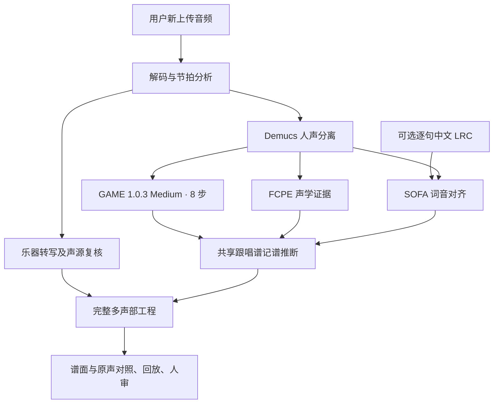

# 工作电脑交接 · 2026-11-09

## 先恢复可用环境

仓库：<https://github.com/zzzhhn/coro-workbench>。以合并后的 `origin/main` 为基线。
先检查工作电脑当前分支、未提交修改与正在运行的进程；保留原工作，避免强制重置。
Node 使用 `.nvmrc` 的 22.x，Python 使用 `.python-version` 的 3.11。
依次阅读 `docs/SETUP.md`、`docs/game-import.md` 和本文，再运行 `npm ci`、
`npm run doctor`。音频环境按安装文档单独配置，随后用 `npm start` 启动。
前端为 `127.0.0.1:5173`，后端为 `127.0.0.1:8765`。
确认 `/api/health` 指向当前 checkout 和源码指纹，不能复用另一份目录的旧后端。

GitHub 只同步代码、测试、脚本和文档，不同步下列本机数据：

- 原始歌曲、手扒谱和 `.coro` 工程。浏览器工程库不随 Git 迁移，便携 `.coro` 才能携带勾选的媒体。
- `models/`、`.venv*`。重装环境或私下迁移模型实体后重新注册，不能照搬旧机器绝对路径的软链接。
- `data/` 分析任务及 `evidence/` 的实验、三方对照和截图。没有这些输入时，私人审阅页不会自动显示内容。

主开发可直接从新的上传开始；复现实验则需要私下带回相应输入。
相关私人目录为 `evidence/vocal-ab-20261107`、`evidence/pipeline-ab-20261108`、
`evidence/lyrics-assisted-20261108`、`evidence/lyrics-readable-20261108`、
`evidence/lyrics-phrasing-20261108`、`evidence/game-import-20261108`。
按需迁移，不把这些内容提交到公开仓库。

## 当前实际产品路线



正常「多声部总谱」和「分轨转谱」默认 `decoder=game`。多声部乐器仍由
YourMT3+ 及现有声源复核处理；GAME 替换主唱，不替换所有乐器。
参数固定 Medium、8 步、阈值 0.2。缺失或失败时明确报错，不能静默退回旧主唱。
直接转谱及明确选择的旧版路线保留原引擎。

`server/game.py`、`game_runner.py` 负责新上传推理；`singing_evidence.py`、
`singing_pipeline.py`、`singing_score.py` 与 `scripts/build-lyrics-pilot.py`
共用证据和记谱推断。运行时不读手扒谱、私有候选工程或指定歌曲的小节答案。
旧主唱证据还参与弦乐同音支持，不能为了省时随意移除乐器复核流程。

可选 LRC 只有句级时间与歌词，不是音符答案。SOFA 进一步找实际音节边界；
目前没有自动补全整首歌词的 ASR 流程。无歌词上传不等于歌词辅助 V3。
旧工程不会自动升级，重新上传才执行新路线。

每个新任务保留 `request.json`、`game/raw.json`、`game/score-evidence.json`、
`analysis-evidence.json`、`project.json`。原始 GAME 工程可从
`/api/projects/{id}/game-raw` 下载。旧版节奏重建对 GAME 工程禁用，避免再次覆盖主唱。

## v5 更新（2026-11-09 晚）

当前流水线以 `docs/PIPELINE.md` 为准，钢琴记谱 `multiscore-rhythm-5`、声源复核
`multiscore-sources-7`、主唱 `syllable-phrasing-4`。主要变化：

- **钢琴记谱**：左右手分界随音乐移动；只有起音按音高顺序扫过才写琶音（播放时按实测
  先后滚动）；每只手最多两个声部；内声部只在实测踏板和自身释放都支持时保持。
- **新上传的工程自带来源标记** `source.pipeline`（流水线代次、提交、代码指纹、各组件
  版本）。打开旧流水线生成的工程会显示提示条，可一键用当前流水线重新转写；工程库的
  「本机转谱结果」列表也会标注「当前流水线 / 旧版流水线」和生成时间。浏览器工程库里
  的旧工程不会自动升级。
- **每个任务的实际流程**写入 `pipeline-manifest.json`，并在「转写修正提案」里显示。
  manifest 记录 worker 自己加载的代码指纹；若和后端不一致，`matchesBackend=false`。
- **带 LRC 上传**不再因为 SOFA 源码没有 `.git` 而崩溃；GAME align 与无词音节边界
  在记谱完成后另存为证据，不改谱。
- **多个 worktree 并行**：端口可配置，重模型用机器级分析锁串行；测试使用私有锁。
- **评估**：`server/score_eval.py` 只用于验收，含逐音错误分类。


## 已有证据与边界

2026-11-08 曾从正式 UI 重新上传完整《空耳》，时长 267.102 秒。
同一输入下原始 GAME 377 个事件与固定 Medium 实验逐项一致，波形及模型哈希一致；
无歌词成谱 379 音。共享实现重算歌词辅助 V3 输入为 358 音，与重构前结果一致。
这些数量只能证明路线一致，不能证明哪份谱更正确。

另有正式 UI 的短片段 LRC 上传及 API 分轨上传成功记录，实际谱面渲染和播放进度已检查。
不能把播放有输出称作已经听觉验收。最新具体记录在私人
`evidence/game-import-20261108/REVIEW.md`，没有同步该目录时不要编造其内容。

前端工程库、命名版本、校对草稿持久化、分页阅谱、谱面和演奏标记处理，以及
全曲乐器/人声研究模块都包含在本次代码基线中。它们不是完整歌曲识别准确率的承诺。

## 下一步优先级和验收方式

P0 是完整歌曲能够正常阅读、照着唱奏的多声部总谱。继续固定 GAME Medium，
优先解决异常附点和切分、无词转音碎片、漏音/八度错误，再处理后段混轨、弦乐长音
和过度拆分乐器。用户更认可必要时呈现弦乐合奏，不应把模型类别当作已确认演奏者。

《空耳》手扒谱是用户高度认可的验收参考。第 13～24、45～54 小节及最近反馈的
21～35 小节需要逐段复核。最近反馈包括「谎」「起」及无词转音碎音、21/22/25
小节附近多余附点、30 小节短音时值、31 小节重复音/音高序列、32 小节还原音误识别、
33～35 小节整句节奏。以原图、原声和实际参考谱核对，勿仅凭文字硬编码音符。

每次只改一个层次：固定 Medium 改记谱推断，或固定音符改弦乐合奏呈现，或固定
语义谱改排版。保留原始 Medium、前版记谱、当前候选三方对照。检查真正上传生成
的正式 Coro 工程，不能只发布预生成示例就声称完成集成。

必须实际查看渲染谱面；有可用音频工具时对照原声和回放，不能直接听时明确使用的
模型辅助及其局限。用户听觉反馈是独立验收，测试通过不替代人审。不要统一删短音、
拉长音符、合并同音或改快 BPM 来美化数字；保留真实转音、重唱、换气和长音。
人工改谱不能算自动识别修复。参考谱若用于训练，另立可追溯且防泄漏的训练/验收划分。

## 开发验证

```sh
npm test -- --maxWorkers=1
npm run test:scripts
npm run build
python -m pytest -q
npm run test:e2e
```

Python CI 使用 `requirements-test.txt`，不下载模型。私人证据和重模型测试可选跳过，
因此 CI 只证明代码和交互回归；真实音频推理须另外验收。启动新浏览器、重模型或
并行任务前检查资源，机器紧张时串行执行。不要清理用户资产或中断其他任务。
